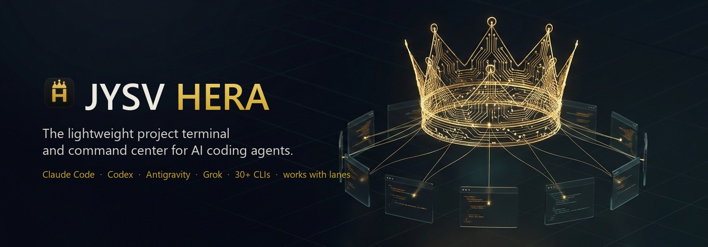
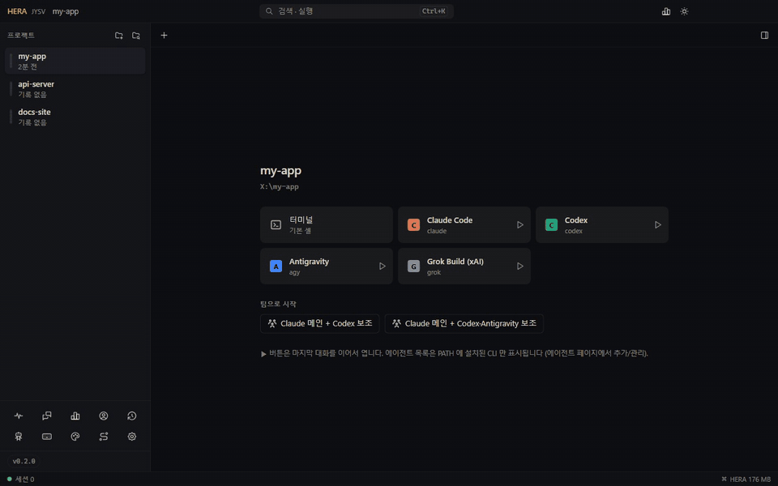
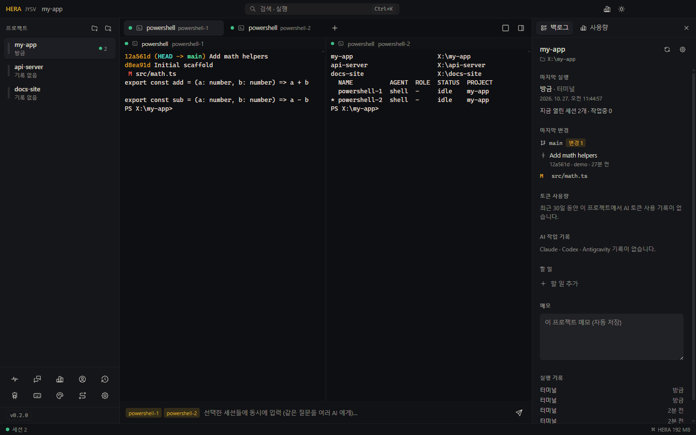
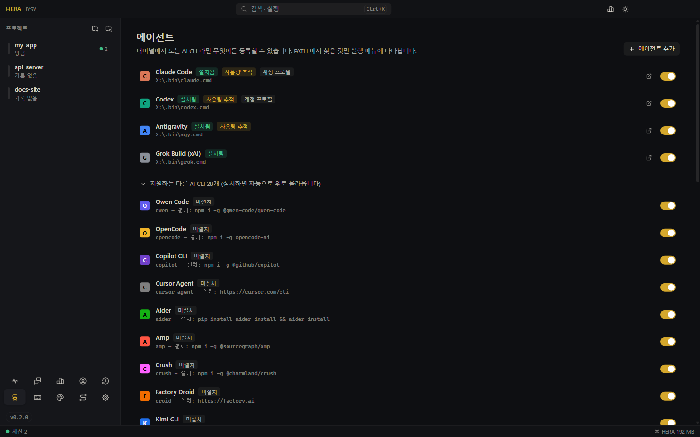
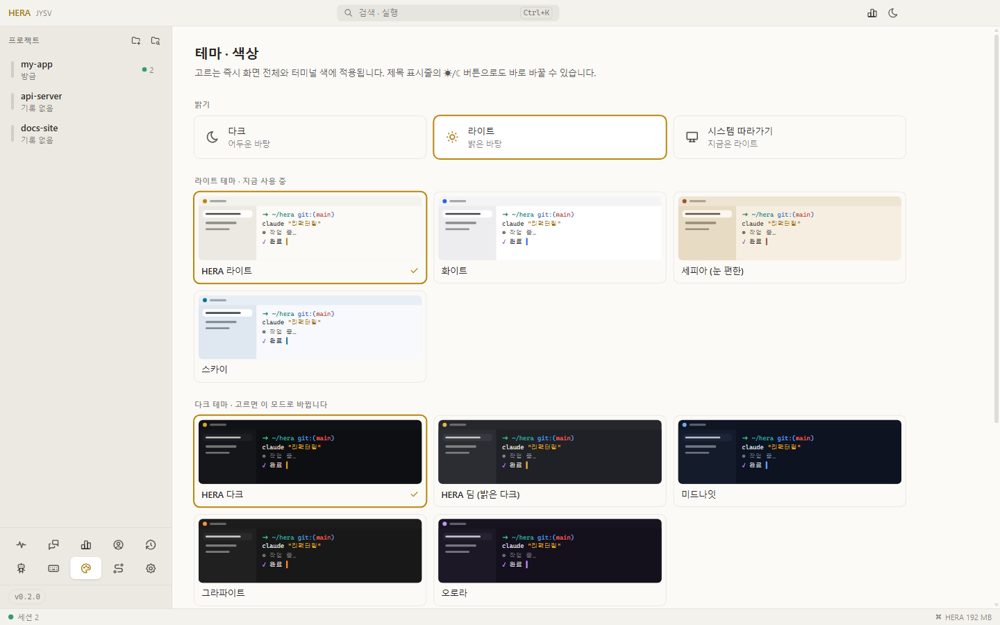
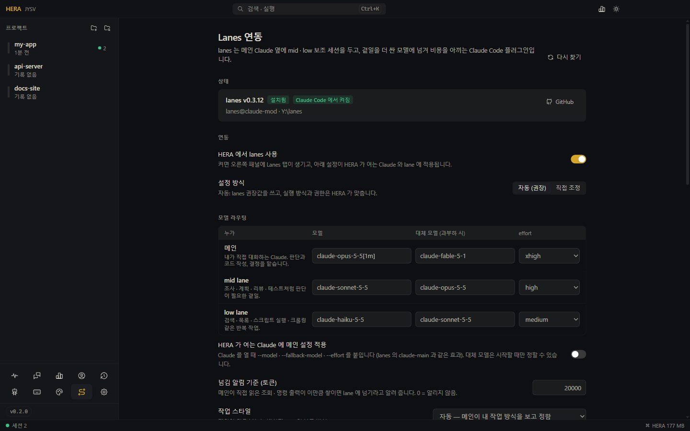

<div align="center">



[](https://github.com/jysvai/JYSV-HERA/releases/latest)
[](https://github.com/jysvai/JYSV-HERA/actions/workflows/release.yml)
[](https://github.com/jysvai/JYSV-HERA/releases)
[](LICENSE)
<br>


[](https://github.com/jysvai/lanes)

[English](README.md) · **한국어**

[다운로드](#설치) · [기능](#기능) · [hera CLI](#멀티-에이전트-협업-hera-cli) · [lanes](#lanes-와-같이-쓰기) · [구조](docs/architecture.md)

</div>

<p align="center"></p>

## 왜 HERA 인가

AI 코딩 에이전트는 터미널에서 돌지만, 터미널은 그걸 위해 만들어지지 않았습니다. 프로젝트 폴더로 `cd` 하고, 에이전트를 켜고, 두 번째 에이전트는 창을 또 열고, 어느 쪽이 승인을 기다리는지 놓치고, 재부팅하면 모든 대화를 처음부터 다시 시작합니다.

HERA 는 원래 쓰던 셸(PowerShell, cmd, Git Bash, bash, zsh, fish)을 그대로 두고, 그 주변에 빠져 있던 것을 채웁니다.

- **프로젝트 중심.** 폴더를 한 번 등록하면 클릭 · 트레이 메뉴 · 전역 단축키로 그 프로젝트의 터미널이나 AI 를 바로 엽니다.
- **모든 AI 를 한곳에서.** Claude Code, Codex, Antigravity, Grok, Muse, Mistral Vibe, Kiro, Goose 등 20개가 넘는 CLI 를 탭이나 분할 화면으로 돌리고, 누가 작업 중이고 누가 나를 기다리는지 한눈에 봅니다.
- **AI 끼리 일 넘기기.** HERA 안의 모든 터미널에 `hera` 명령이 있어서, 한 AI 가 다른 AI 에게 일을 맡기고 결과를 받아 옵니다.
- **재부팅해도 그대로.** 세션을 계속 저장해 두었다가, 다운 · 재부팅 뒤에 셸은 마지막 폴더에서, Claude Code · Codex 는 *그 탭이 하던 대화 그대로* 이어서 엽니다.
- **보이는 사용량.** 5시간 · 주간 한도, AI 별 · 프로젝트별 토큰과 비용을 터미널 바로 옆에서 봅니다.
- **가벼움.** 터미널 1개 기준 약 170 MB, 하나 늘 때마다 약 11 MB, 쉴 때 CPU 는 거의 0. 자세한 수치는 아래에.



## 기능

| | |
|---|---|
| **프로젝트 런처** | 등록한 프로젝트 사이드바 (상위 폴더를 고르면 하위 프로젝트를 찾아 한 번에 등록). 프로젝트마다 터미널 · 설치된 AI · 팀 버튼이 있는 시작 화면. 더블클릭 = 바로 터미널. |
| **탭 · 분할** | 탭, 최대 4개 나란히 보기, 한 질문을 여러 AI 에게 동시에 보내기. 파일을 끌어다 놓으면 셸에 맞게 따옴표 처리된 경로 입력. |
| **실시간 상태** | 세션마다 작업 중 / 대기 / 승인 대기를 판정하고, AI 가 끝났거나 내가 필요할 때 알림. |
| **백로그 패널** | 마지막 실행(언제 · 무엇으로), git 브랜치 · 마지막 커밋 · 변경 파일, AI 별 마지막 지시, 할 일과 메모. |
| **멀티 에이전트 버스** | 세션 사이의 `hera ask / send / reply / peek / key / spawn`. 모든 메시지는 *에이전트 대화* 페이지에 기록. |
| **세션 기억** | 45초마다 · 변경 때마다 자동 저장, Claude Code(`--session-id` / `--resume <id>`)와 Codex(`resume <id>`)는 정확히 그 대화로 재개, 로그인 시 자동 실행. |
| **사용량** | 한도, AI 별 · 등록 프로젝트별 · 전체의 오늘 / 7일 / 30일 토큰과 API 정가 환산 비용. 별도 프로세스에서 로컬 기록만 읽음. |
| **계정** | CLI 마다 설정 폴더를 따로 둔 프로필(`CLAUDE_CONFIG_DIR`, `CODEX_HOME` …)로 회사 / 개인 로그인을 분리. |
| **테마** | 다크 / 라이트 / 시스템, 프리셋 9개, 강조색, 글자 선명하게, 터미널 16색까지 바꾸는 내 색상 편집기. |
| **AI CLI 32종 내장** | 아래 목록 참고. 그 밖의 명령(예: `ollama run <모델>`)은 에이전트 페이지에서 추가. |
| **lanes 연동** | [lanes](https://github.com/jysvai/lanes) 의 mid / low 보조 세션을 HERA 탭에서 돌리고, 모델 라우팅 · 권한 · 프로젝트별 지시를 한 설정 페이지에서. |
| **버전 확인** | 사이드바 아래에 설치된 버전이 표시되고, 새 릴리스가 나오면 업데이트 버튼으로 바뀝니다 (터미널에서는 `hera --version`). |

<table>
<tr>
<td width="50%"></td>
<td width="50%"></td>
</tr>
<tr>
<td align="center">AI CLI 32종, <code>PATH</code> 에서 자동 감지</td>
<td align="center">테마 · 라이트 모드</td>
</tr>
</table>

### 지원하는 AI CLI

설치된 CLI 는 `PATH` 에서 찾아 실행 메뉴에 나타나고, 나머지는 에이전트 페이지에 설치 명령 · 홈페이지와 함께 접혀 있습니다.

| 공식 에이전트 | | | |
|---|---|---|---|
| Claude Code (Anthropic) | Codex (OpenAI) | Antigravity (Google) | Grok Build (xAI) |
| Muse Code (Meta) | Mistral Vibe | Kiro CLI (Amazon) | Copilot CLI (GitHub) |
| Junie (JetBrains) | Rovo Dev (Atlassian) | Jules Tools (Google) | Devin CLI |
| Cursor Agent | Qwen Code | Kimi CLI | Factory Droid |
| **오픈소스 · 기타** | | | |
| OpenCode | Goose | Cline CLI | Continue CLI |
| Auggie (Augment) | Kilo Code CLI | Qoder CLI | Amp |
| Aider | Crush | Letta Code | Codebuff |
| Codewhale (DeepSeek, 커뮤니티) | Hermes Agent (Nous) | LM Studio `lms chat` (로컬 모델) | `llm chat` (로컬 · 모든 API) |

Google 의 Gemini CLI 는 Google 계정 사용자에게 Antigravity 로 대체되어 내장 목록에서 뺐습니다. API 키로 계속 쓴다면 에이전트 페이지에서 `gemini` 를 추가하세요.

## 가볍게 만든 방식

Windows 11(논리 코어 16개)에서 각 앱에 Windows PowerShell 5.1 터미널을 열어 두고 쉬는 상태에서 직접 측정했습니다. 메모리는 앱 자체 프로세스의 Private Bytes 입니다. 셸(하나에 약 55 MB)은 어느 앱이든 같으므로 뺐습니다.

| 앱 | 터미널 1개 | 터미널 4개 | 쉴 때 CPU |
|---|---:|---:|---:|
| 기본 콘솔 창 (conhost) | 2.8 MB | 10 MB | ~0.01% |
| Windows Terminal (공유 프로세스에 늘어나는 양) | +25 MB | +110 MB | 구분 불가 |
| **JYSV HERA 0.2.0** | **170 MB** | **203 MB** | **0.01–0.05%** |
| VS Code (확장 끔, 빈 폴더) | 1,100 MB | 1,169 MB | 0.02–0.24% |

기본 콘솔 창이 더 가볍다는 건 사실입니다. HERA 의 기본 비용은 Chromium 화면입니다. 대신 그 비용이 늘지 않게 막습니다.

- 터미널 상태는 메인 프로세스의 헤드리스 xterm 이 들고 있습니다. 화면은 보이는 터미널만 그리고, 출력은 약 8 ms 에 한 번으로 묶습니다.
- 창을 숨기면 화면으로 아무것도 보내지 않습니다. 10분(설정 가능)이 지나면 화면 프로세스까지 내려 메모리를 돌려주고, 터미널은 계속 돕니다.
- GPU 가속은 기본 꺼짐입니다(켜면 약 135 MB 증가). 화면 프로세스는 하나뿐이고 예비 프로세스도 두지 않습니다.
- 사용량은 일을 마치면 바로 종료되는 별도 프로세스에서 증분으로 집계하며, 최대 5분에 한 번 돕니다.
- 0.2.0 에서 두 가지를 줄였습니다. 터미널마다 붙는 node-pty 출력 스레드의 힙을 제한했고, WebGL 렌더러는 GPU 모드에서만 불러옵니다. 둘을 합쳐 터미널 4개 기준 약 23 MB 가 줄었고, 30만 줄 출력 시험에서도 터미널이 정상 동작했습니다.
- 설치 파일마다 그 OS 의 node-pty 바이너리만 넣습니다. Windows 에서는 압축되지 않은 네이티브 파일이 9.3 MB 에서 1.5 MB 로 줄었습니다.

## 설치

**[Releases](https://github.com/jysvai/JYSV-HERA/releases/latest)** 에서 받으세요. 모든 설치 파일은 GitHub Actions 가 각 OS 에서 직접 빌드하고, 그 OS 에서 자체 시험을 통과해야만 올라갑니다. 시험 내용: 포장된 앱이 실제 터미널을 열어 명령을 실행하고, 함께 들어 있는 `hera` CLI 를 실행하고, 창을 그리는지.

| OS | 파일 | 방법 |
|---|---|---|
| **Windows 10 / 11** (x64) | `…-win-x64.exe` | 사용자 단위 설치, 관리자 권한 불필요. 아직 코드 서명이 없어서 SmartScreen 이 막으면 *추가 정보 → 실행*. 설치 없이 쓰는 `…-win-x64.zip` 도 있습니다. |
| **macOS 12+** Apple Silicon | `…-mac-arm64.dmg` | 응용 프로그램 폴더로 끌어다 놓기. 공증(notarize)되지 않아 처음 한 번은 우클릭 → *열기*, 또는 `xattr -dr com.apple.quarantine "/Applications/JYSV HERA.app"`. |
| **macOS 12+** Intel | `…-mac-x64.dmg` | 위와 같음. |
| **Ubuntu 20.04+ / Debian 11+** | `.deb` | `sudo apt install ./JYSV-HERA-*.deb` |
| **Rocky / Alma / RHEL 9+, Fedora** | `.rpm` | `sudo dnf install ./JYSV-HERA-*.rpm` |
| **모든 Linux** (x64) | `.AppImage` | `chmod +x JYSV-HERA-*.AppImage` 후 실행. `.tar.gz` 도 있습니다. |

모든 파일의 체크섬은 `SHA256SUMS.txt` 에 있습니다. 쓰려는 AI CLI(예: [Claude Code](https://claude.com/claude-code), [Codex](https://github.com/openai/codex))는 따로 설치되어 `PATH` 에 있어야 합니다.

지금까지 실사용은 Windows 에서 했고, macOS · Linux 빌드는 위의 자체 시험을 통과한 상태입니다. 그 OS 에서 다르게 동작하는 점이 있으면 알려 주세요.

## 처음 쓰기

1. **프로젝트 등록**: 📁+ 로 폴더를 추가하거나, 🔍 로 상위 폴더(예: `Desktop`)를 골라 `.git`, `package.json`, `pyproject.toml` 등으로 프로젝트를 찾아 한 번에 등록합니다.
2. **열기**: 프로젝트를 고르면 시작 화면에 *터미널*, 설치된 AI, 팀 버튼이 나옵니다. ▶ 는 그 AI 의 마지막 대화를 이어서 엽니다.
3. **작업**: 위쪽 탭, 최대 4개 분할, 오른쪽 패널의 *백로그 · 사용량 · Lanes*.
4. **편하게 닫기**: 창을 닫아도 트레이에서 터미널은 계속 돕니다. 종료 후 다시 켜거나 재부팅해도 모든 세션이 돌아옵니다.

## 멀티 에이전트 협업: `hera` CLI

HERA 안의 모든 터미널에는 `hera` 가 `PATH` 에 있고, AI 도 그대로 씁니다.

```text
hera list                        이 프로젝트의 세션들 (* = 나)
hera ask codex-1 "작업"           일을 넘기고 끝날 때까지 기다려 결과 화면을 받음
hera send codex-1 "작업"          넘기고 바로 계속 (상대가 hera reply 로 회신)
hera reply claude-1 "요약"        받은 [HERA msg from …] 에 회신
hera peek agy-1 -n 60            다른 세션 화면 읽기
hera key claude-1 down enter     다른 세션에 키 입력 (승인 프롬프트 등)
hera spawn grok                  이 프로젝트에 보조 AI 띄우기
hera open <프로젝트> --agent claude · hera add [경로] · hera projects
hera guide                       AI 에게 줄 협업 규칙 전문
hera --version                   설치된 HERA 버전
```

팀 프리셋(예: *Claude 메인 + Codex 보조*)으로 시작하면 메인 AI 에게 팀 구성과 이 규칙이 자동으로 전달됩니다. 실제 확인한 흐름: Claude → `hera ask codex-1 "calc.py 에 sub() 추가"` → Codex 가 수정 · 테스트 → `hera reply claude-1 "…"` → Claude 가 파일을 확인하고 보고.

## lanes 와 같이 쓰기



[**lanes**](https://github.com/jysvai/lanes) 는 메인 Claude 옆에 **mid** lane(조사 · 계획 · 리뷰 · 테스트)과 **low** lane(검색 · 스크립트 · 크롤링)을 두는 Claude Code 플러그인입니다. 곁일은 더 싼 모델로 보내고 결과만 돌려받으니, 메인은 가볍게 유지되고 비용은 줄어듭니다. HERA 와 lanes 는 역할이 겹치지 않습니다. `hera` 는 서로 다른 회사의 AI 를 섞어 쓰고, lanes 는 Claude 한 세션의 일을 더 싼 Claude 모델들에 나눕니다.

lanes 가 설치되어 있으면 HERA 가 알아서 찾아 **Lanes 페이지**와 오른쪽 패널의 **Lanes 탭**을 붙입니다.

- **HERA 탭에서 lane 실행.** HERA 에서 여는 lane 은 별도 창이 아니라 그 프로젝트의 탭으로 열립니다. lanes 자신의 실행 스크립트를 그대로 쓰므로 역할 지시 · 플래그 · 안전 규칙은 lanes 가 정한 그대로입니다.
- **실시간 패널.** lane 마다 상태, 지금 하는 일, 대기열, 최근 작업과 결과(누르면 보고서), 오늘 lane 비용과 메인 모델 대비 아낀 금액.
- **모델 라우팅.** 메인 · mid · low 의 모델, 대체 모델, effort, 넘김 알림 기준과 작업 스타일. *자동*은 lanes 권장값, *직접 조정*은 모든 값을 엽니다. 값은 Claude Code `settings.json` 의 lanes 항목에 저장되며, 처음 바꿀 때 원본을 한 번 백업합니다.
- **권한.** lane 권한 모드와 `dontAsk` 용 허용 목록. 자동 모드에서는 lane 을 열 때 이 목록을 프로젝트의 `.claude/settings.local.json` 에 넣습니다. lanes 는 lane 의 코드 편집과 git 쓰기를 항상 막습니다.
- **프로젝트별 지시.** `.claude/lanes/roles/mid.md` · `low.md` 를 HERA 에서 고치거나, 프로젝트에 저장된 명령으로 초안을 만듭니다.
- **메인 세션 플래그 (선택).** HERA 가 Claude 를 열 때 lanes 의 메인 모델 · 대체 모델 · effort 를 붙일 수 있습니다(lanes 의 `claude-main` 과 같은 효과). 기본은 꺼짐이라 내가 정한 모델이 그대로 쓰입니다.

<br clear="right">

lanes 는 Claude Code 프롬프트에서 한 번 설치하고, *Lanes → HERA 에서 lanes 사용* 을 켜면 됩니다.

```text
/plugin install lanes --marketplace jysvai/lanes
```

처음부터 끝까지 확인했습니다: HERA 의 메인 Claude 가 `/lane low …` 로 넘긴 일을 HERA 탭의 low lane 이 처리해 답했고, 그 답이 메인으로 돌아왔습니다.

## 세션 기억

- 열린 터미널은 45초마다, 탭을 열고 닫을 때마다, 그리고 로그오프 · 종료 · 절전 순간에 `sessions.json` 에 저장됩니다.
- 다음에 켜면 (*설정 → 세션 기억 → 자동으로 이어서 실행*, 기본값):
  - 셸은 **마지막에 있던 폴더**에서 다시 열립니다(OSC 7 / OSC 9;9 와 프롬프트로 추적).
  - Claude Code 는 HERA 가 정해 준 `--session-id` 의 대화로, Codex 는 기록에서 찾은 세션으로 이어집니다. 같은 폴더에 Claude 탭이 여러 개여도 각자 자기 대화로 돌아갑니다.
  - 다른 AI 는 각자의 "최근 대화 이어하기" 옵션을 씁니다. 개발 서버 같은 프로젝트 명령은 자동으로 다시 실행하지 않고 *다시 시작* 버튼으로 재개합니다.
- *컴퓨터를 켜면 HERA 자동 실행*(설치본)과 함께 쓰면 재부팅 직후 바로 이어서 일할 수 있습니다.

## 테마 · 읽기 편한 화면

- **밝기:** 다크 / 라이트 / 시스템. 테마 페이지나 제목 표시줄의 ☀/☾ 버튼으로 바꿉니다.
- **프리셋:** HERA 다크, 딤, 미드나잇, 그라파이트, 오로라, HERA 라이트, 화이트, 세피아, 스카이.
- **읽기 편하게:** 강조색 12개 또는 아무 색, 글자 선명하게 옵션.
- **내 색상 만들기:** 아무 테마나 복제해서 배경 · 사이드바 · 카드 · 글자 · 강조색 · 터미널 색 · ANSI 16색을 하나씩 바꾸고, 바꾸는 즉시 미리 봅니다.

## 단축키

| | Windows / Linux | macOS |
|---|---|---|
| 명령 팔레트 | `Ctrl+K`(터미널 밖) / `Ctrl+Shift+P` | `⌘K` |
| 새 터미널 / 닫기 | `Ctrl+Shift+T` / `Ctrl+Shift+W` | `⌘T` / `⌘W` |
| 백로그 / 사용량 패널 / 세션 현황 | `Ctrl+Shift+B` / `Ctrl+Shift+U` / `Ctrl+Shift+J` | `⌘B` / `⌘U` / `⌘J` |
| 다음 탭 / N번째 탭 | `Ctrl+Tab` / `Alt+1…9` | 같음 |
| 창 보이기 · 숨기기 (전역) | `Ctrl+Alt+Space` | `⌘⇧Space` |
| 복사 / 붙여넣기 | `Ctrl+C`(선택 시) · `Ctrl+Shift+C` / `Ctrl+V` | `⌘C` / `⌘V` |

## 개인정보

- **네트워크 요청은 하나, 그마저 끌 수 있음.** 업데이트 버튼을 띄우려고 하루 몇 번 GitHub 에 이 저장소의 최신 릴리스만 물어봅니다. *설정 → 버전 · 업데이트 → 새 버전 자동 확인* 을 끄면 아무 데도 접속하지 않습니다.
- **원격 수집 없음.** 사용량은 각 CLI 가 이미 이 컴퓨터에 남긴 기록에서 계산합니다.
- **비밀 값은 읽지 않음.** 계정 화면은 플랜 · 이메일 · 만료일처럼 비밀이 아닌 값만 보여 주고, 토큰 값은 읽지 않습니다.
- **데이터는 내 컴퓨터에.** `%APPDATA%\JYSV HERA`(macOS `~/Library/Application Support/JYSV HERA`, Linux `~/.config/JYSV HERA`)에 있습니다. `HERA_HOME` 환경변수로 다른 폴더를 지정하면 그 폴더를 쓰는 별도 인스턴스로 실행됩니다.

## 소스에서 빌드

```bash
npm ci
npm run dev          # vite + esbuild watch + electron (데이터는 .hera-dev, 별도 파이프)
npm run typecheck
npm run build        # dist/
npm run dist:win     # release/ — Windows 에서
npm run dist:mac     # macOS 에서
npm run dist:linux   # Linux 에서 (node-pty 를 그 자리에서 컴파일)
```

구성: Electron 40, React 19, nanostores, Tailwind 4, xterm.js 6(화면) + `@xterm/headless`(메인), node-pty(Windows 는 ConPTY). 터미널 파이프라인, 세션 기억, 상태 판정, 메시지 버스, 사용량, lanes 연동, 릴리스 파이프라인 같은 내부 구조는 [docs/architecture.md](docs/architecture.md) 에 정리했습니다.

`HERA_SMOKE=<결과.json> <앱>` 으로 릴리스 파이프라인과 같은 자체 시험을 직접 돌릴 수 있습니다.

## 출처

HERA 의 창, 디자인 토큰, UI 기본 부품은 [Hermes Agent](https://github.com/NousResearch/hermes-agent)(MIT, Nous Research) 데스크톱 셸의 구조를 따릅니다. 그 셸을 REA 로 분석한 뒤, Hermes 의 Python 백엔드 없이 다시 만들었습니다. 이름은 **HE**rmes + **R**E**A**, AI 들을 지휘하는 여왕에서 왔습니다.

## 라이선스

[GNU Affero General Public License v3.0 only](LICENSE)(AGPL-3.0-only). Hermes Agent 의 MIT 라이선스를 포함한 서드파티 고지는 [THIRD_PARTY_NOTICES.md](THIRD_PARTY_NOTICES.md) 에 있습니다.
