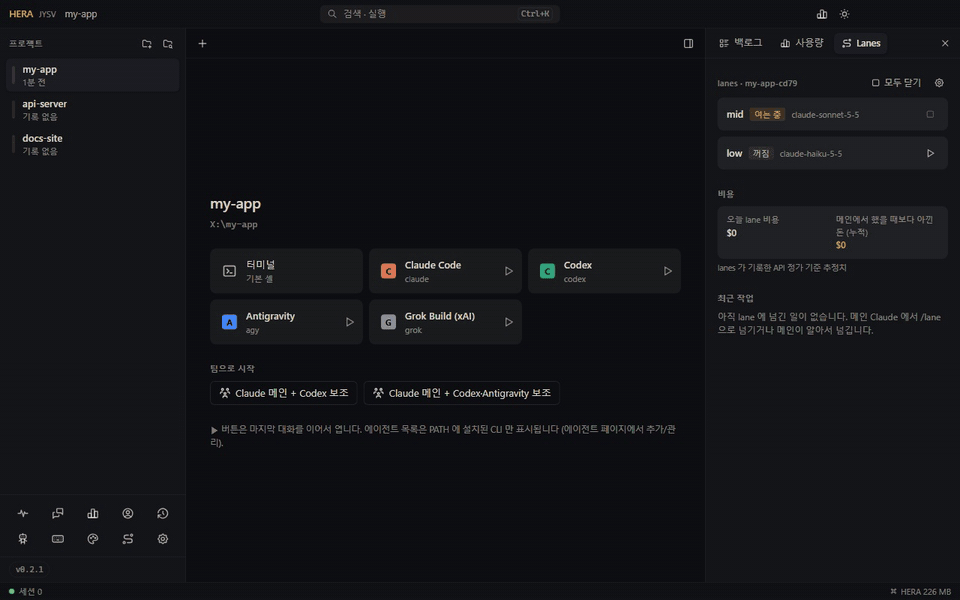
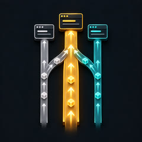
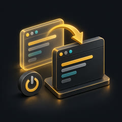

<div align="center">


[](https://github.com/jysvai/JYSV-HERA/releases/latest)
[](https://github.com/jysvai/JYSV-HERA/actions/workflows/release.yml)
[](https://github.com/jysvai/JYSV-HERA/releases)
[](LICENSE)
<br>


[](https://github.com/jysvai/lanes)

**English** · [한국어](README.ko.md)

[Download](#install) · [What's new](#whats-new-in-021) · [Features](#features) · [Docs](#documentation) · [hera CLI](#multi-agent-collaboration-the-hera-cli) · [lanes](#works-great-with-lanes) · [Patch notes](docs/patch-notes/README.md)

</div>

<p align="center"></p>

## Why HERA

AI coding agents live in terminals, and terminals were not built for them. You `cd` into a project, start an agent, open another window for a second agent, lose track of which one is waiting for approval, and after a reboot you start every conversation from scratch.

HERA keeps the shell you already use (PowerShell, cmd, Git Bash, bash, zsh, fish) and adds what is missing around it:

- **Projects first.** Register folders once; open a terminal or an agent in any of them with one click, a tray menu or a global hotkey.
- **Every agent, one place.** Claude Code, Codex, Antigravity, Grok, Muse, Mistral Vibe, Kiro, Goose and 20+ more CLIs run in tabs or a split view, and you see at a glance which one is working, idle or waiting for you.
- **Agents that delegate.** Every HERA terminal has a `hera` command, so one agent can hand a task to another and get the result back.
- **Nothing lost on reboot.** Sessions are saved continuously; after a crash or a reboot, shells reopen in their last folder and Claude Code / Codex resume *the exact conversation each tab was in*.
- **Usage you can see.** 5-hour and weekly limits, tokens and cost per AI and per project, right beside your terminals.
- **Light.** About 170 MB with one terminal and about 11 MB more per extra terminal, idle CPU near zero. Details below.


## What's new in 0.2.1

Terminals now behave like Windows Terminal, and lanes stay inside HERA. Full notes: [docs/patch-notes](docs/patch-notes/README.md) · [v0.2.1](docs/patch-notes/en/v0.2.1.md).

<table>
<tr>
<td width="50%"></td>
<td width="50%"></td>
</tr>
<tr>
<td><b>The wheel works in full-screen programs.</b> HERA ships Windows Terminal's console engine (ConPTY), so Claude Code's full-screen mode, vim and htop scroll with the mouse instead of getting arrow keys. Tab switches keep the mouse mode, cursor and scroll region.</td>
<td><b>Every lane opens as a HERA tab.</b> With lanes 0.3.13, a lane the main Claude opens by itself asks HERA for a tab (<code>hera host --lane</code>). Only projects registered in HERA are taken over; anything else opens as before.</td>
</tr>
</table>

<p align="center"></p>

- **Your old terminal's settings come along.** *Settings → Terminal* imports Windows Terminal's font, cursor, scrollback, default shell and color scheme, item by item.
- **Any shell.** PowerShell, PowerShell 7, cmd, Git Bash, WSL, or any command line such as `wsl.exe -d Ubuntu`. Cursor shape and blink are settings now, and Cascadia Mono ships with HERA.
- **Fixed:** double paste, screens that broke after a tab switch or resize, rows that stayed stale until you scrolled, and lane replies lost after a restart (a lane's conversation was resumed in the main tab).

## Features

| | |
|---|---|
| **Project launcher** | Sidebar of registered projects (or scan a parent folder to add them all). Start screen per project with a terminal, every installed AI and team presets. Double-click = terminal. |
| **Tabs and split view** | Tabs, up to 4 terminals side by side, broadcast one prompt to several agents at once. Drag a file onto a terminal to paste its quoted path. |
| **Live status** | Working / idle / waiting-for-approval detected per session; desktop notifications when an agent finishes or needs you. |
| **Backlog panel** | Last run (when and with what), git branch, last commit and changed files, each AI's last prompt, todos and notes per project. |
| **Multi-agent bus** | `hera ask / send / reply / peek / key / spawn` between sessions; every message is logged on the *Agent conversations* page. |
| **Session memory** | Autosave every 45 s and on every change; exact conversation resume for Claude Code (`--session-id` / `--resume <id>`) and Codex (`resume <id>`); optional launch at login. |
| **Usage** | Limits, today / 7-day / 30-day tokens and API-price cost per AI, per registered project and in total, parsed locally in a short-lived worker. |
| **Accounts** | Profiles with separate config folders per CLI (`CLAUDE_CONFIG_DIR`, `CODEX_HOME`, ...) so work and personal logins stay apart. |
| **Themes** | Dark / light / follow system, 9 presets, accent colors, high-contrast text, and a custom theme editor down to the 16 terminal colors. |
| **32 agent CLIs built in** | See the list below; add any other command (for example `ollama run <model>`) on the Agents page. |
| **lanes integration** | Run [lanes](https://github.com/jysvai/lanes) mid/low helper sessions inside HERA tabs, with model routing, permissions and per-project instructions in one settings page. |
| **Feels like your old terminal** | Ships Windows Terminal's console engine (ConPTY) and font (Cascadia Mono), so mouse and wheel work in full-screen TUIs such as Claude Code's, vim and htop. Takes over Windows Terminal's font, cursor, scrollback, color scheme and default shell on request. Any shell: PowerShell, pwsh, cmd, Git Bash, WSL or a command line you type. |
| **Version check** | The sidebar shows the installed version and turns into an update button when a newer release is out (`hera --version` in a terminal). |

<table>
<tr>
<td width="50%"></td>
<td width="50%"></td>
</tr>
<tr>
<td align="center">32 agent CLIs, detected on <code>PATH</code></td>
<td align="center">Themes, light mode</td>
</tr>
</table>

### Supported agent CLIs

Installed CLIs are detected on `PATH` and appear in the launcher; the rest stay folded on the Agents page with their install command and homepage.

| Vendor agents | | | |
|---|---|---|---|
| Claude Code (Anthropic) | Codex (OpenAI) | Antigravity (Google) | Grok Build (xAI) |
| Muse Code (Meta) | Mistral Vibe | Kiro CLI (Amazon) | Copilot CLI (GitHub) |
| Junie (JetBrains) | Rovo Dev (Atlassian) | Jules Tools (Google) | Devin CLI |
| Cursor Agent | Qwen Code | Kimi CLI | Factory Droid |
| **Open source and others** | | | |
| OpenCode | Goose | Cline CLI | Continue CLI |
| Auggie (Augment) | Kilo Code CLI | Qoder CLI | Amp |
| Aider | Crush | Letta Code | Codebuff |
| Codewhale (DeepSeek, community) | Hermes Agent (Nous) | LM Studio `lms chat` (local models) | `llm chat` (local or any API) |

Google's Gemini CLI was replaced by Antigravity for Google accounts, so it is no longer built in; if you use it with an API key, add `gemini` on the Agents page.

## Documentation

One page per feature, in [English](docs/en/README.md) and [Korean](docs/ko/README.md). Also: [Troubleshooting](docs/en/troubleshooting.md) · [Updates and privacy](docs/en/updates-and-privacy.md) · [Patch notes](docs/patch-notes/README.md) · [Architecture](docs/architecture.md).

<table>
<tr>
<td align="center" width="25%"><a href="docs/en/projects.md"><br><b>Projects</b></a></td>
<td align="center" width="25%"><a href="docs/en/terminal.md"><br><b>Terminal</b></a></td>
<td align="center" width="25%"><a href="docs/en/agents.md"><br><b>Agents</b></a></td>
<td align="center" width="25%"><a href="docs/en/hera-cli.md"><br><b>hera CLI</b></a></td>
</tr>
<tr>
<td align="center" width="25%"><a href="docs/en/lanes.md"><br><b>lanes</b></a></td>
<td align="center" width="25%"><a href="docs/en/session-memory.md"><br><b>Session memory</b></a></td>
<td align="center" width="25%"><a href="docs/en/usage.md"><br><b>Usage</b></a></td>
<td align="center" width="25%"><a href="docs/en/themes.md"><br><b>Themes</b></a></td>
</tr>
</table>

## Lightweight by design

Measured on Windows 11 (16 logical cores), each app with idle Windows PowerShell 5.1 terminals. Memory is private bytes of the app's own processes. The shells are left out because they cost the same everywhere (about 55 MB each).

| App | 1 terminal | 4 terminals | Idle CPU |
|---|---:|---:|---:|
| Classic console window (conhost) | 2.8 MB | 10 MB | ~0.01% |
| Windows Terminal (added to its shared process) | +25 MB | +110 MB | not separable |
| **JYSV HERA 0.2.0** | **170 MB** | **203 MB** | **0.01–0.05%** |
| VS Code (extensions off, empty folder) | 1,100 MB | 1,169 MB | 0.02–0.24% |

A bare console window is lighter, and HERA does not pretend otherwise: its fixed cost is the Chromium UI. What it does is keep that cost flat:

- Each terminal's state lives in a headless xterm in the main process. The window renders only the visible terminals, and output is batched to one update per ~8 ms.
- Hidden window: nothing is streamed to it. After 10 minutes hidden (configurable) the UI process is released entirely while terminals keep running.
- GPU acceleration is off by default (it costs about 135 MB). There is a single renderer process and no spare one kept warm.
- Usage is parsed incrementally in a short-lived worker that exits when done, at most every 5 minutes.
- 0.2.0 caps the heap of node-pty's per-terminal output thread and loads the WebGL renderer only in GPU mode. Together they save about 23 MB at 4 terminals, and terminals stayed correct through a 300,000-line output test.
- Each installer ships only its own platform's node-pty binaries: on Windows, unpacked native files went from 9.3 MB to 1.5 MB. 0.2.1 adds Windows Terminal's ConPTY (1.3 MB) and leaves out node-pty's debug symbols.

## Install

Download from **[Releases](https://github.com/jysvai/JYSV-HERA/releases/latest)**. Every build is made on its own OS by GitHub Actions and has to pass a self-test there first: the packaged app opens a real terminal, runs a command, runs the bundled `hera` CLI and renders its window.

| OS | File | How |
|---|---|---|
| **Windows 10 / 11** (x64) | `…-win-x64.exe` | Installer, per user, no admin rights. Not code-signed yet: if SmartScreen asks, choose *More info → Run anyway*. A portable `…-win-x64.zip` is also there. |
| **macOS 12+** Apple Silicon | `…-mac-arm64.dmg` | Drag to Applications. The app is not notarized: the first time, right-click it → *Open*, or run `xattr -dr com.apple.quarantine "/Applications/JYSV HERA.app"`. |
| **macOS 12+** Intel | `…-mac-x64.dmg` | Same as above. |
| **Ubuntu 20.04+ / Debian 11+** | `.deb` | `sudo apt install ./JYSV-HERA-*.deb` |
| **Rocky / Alma / RHEL 9+, Fedora** | `.rpm` | `sudo dnf install ./JYSV-HERA-*.rpm` |
| **Any Linux** (x64) | `.AppImage` | `chmod +x JYSV-HERA-*.AppImage` and run it. A `.tar.gz` is also there. |

`SHA256SUMS.txt` lists the checksum of every file. You also need the AI CLIs you want to use (for example [Claude Code](https://claude.com/claude-code) or [Codex](https://github.com/openai/codex)) installed and on `PATH`.

Daily use so far has been on Windows; macOS and Linux builds pass the self-test above. Please report anything that behaves differently there.

## Quick start

1. **Add projects:** the 📁+ button adds folders; 🔍 scans a parent folder (for example `Desktop`) and finds projects by `.git`, `package.json`, `pyproject.toml` and more.
2. **Open:** pick a project. The start screen shows *Terminal*, every installed AI and team presets. ▶ resumes that AI's last conversation.
3. **Work:** tabs at the top, split view for up to 4, and the right panel for *Backlog · Usage · Lanes*.
4. **Close freely:** closing the window keeps terminals running in the tray. Quitting and reopening, or a reboot, brings every session back.

## Multi-agent collaboration: the `hera` CLI

Every terminal inside HERA has `hera` on its `PATH`, and agents use it just like you do:

```text
hera list                        sessions in this project (* = you)
hera ask codex-1 "task"          hand over a task and wait for the result screen
hera send codex-1 "task"         hand over and continue; the other side answers with hera reply
hera reply claude-1 "summary"    answer a [HERA msg from …]
hera peek agy-1 -n 60            read another session's screen
hera key claude-1 down enter     press keys in another session (approval prompts)
hera spawn grok                  start a helper AI in this project
hera host [--cwd dir] -- <cmd>   open a tab in the registered project holding dir (refused elsewhere)
hera open <project> --agent claude · hera add [path] · hera projects
hera guide                       the full collaboration rules to give an agent
hera --version                   installed HERA version
```

Starting from a team preset (for example *Claude main + Codex helper*) briefs the main agent with the team and these rules automatically. Verified flow: Claude → `hera ask codex-1 "add sub() to calc.py"` → Codex edits and tests → `hera reply claude-1 "…"` → Claude checks the file and reports.

## Works great with lanes


[**lanes**](https://github.com/jysvai/lanes) is a Claude Code plugin that runs a **mid** lane (research, plans, reviews, tests) and a **low** lane (search, scripts, crawling) beside your main Claude session. Side work goes to cheaper models and only the result comes back, so the main session stays fast and the bill shrinks. HERA and lanes cover different ground: `hera` mixes AIs from different vendors, while lanes splits one Claude session's work across cheaper Claude models.

Once lanes is installed, HERA finds it and adds a **Lanes** page and a **Lanes** tab in the right panel:

- **Lanes in HERA tabs.** Every lane of a project registered in HERA opens as a HERA tab instead of a separate window: one you start from HERA, and one the main session opens itself (a task sent to a closed lane, `/lane start`, a lane restarted after it died). lanes 0.3.13+ asks HERA for the tab (`hera host --lane`); HERA agrees only for registered projects, and anywhere else the lane opens in its own window as before. It runs through lanes' own launcher, so its role prompt, flags and safety rules stay exactly as lanes defines them.
- **Restarts keep main and lanes apart.** A lane's conversation is never resumed in a main tab after a restart, so the lanes' replies keep reaching the right main session.
- **Live panel.** Each lane's state, current task, queue, recent tasks with their verdicts (click one to open its report), today's lane cost and the money saved compared with the main model.
- **Model routing.** Model, fallback and effort for main, mid and low, the hand-off reminder threshold and work style. *Auto* uses lanes' recommended values; *Custom* unlocks every option. Values go to the lanes entry of Claude Code's `settings.json`, after a one-time backup.
- **Permissions.** The lane permission mode and an allow-list for `dontAsk` lanes, which Auto mode adds to the project's `.claude/settings.local.json` when it starts a lane. lanes always blocks edits and git writes in lanes.
- **Per-project instructions.** Edit `.claude/lanes/roles/mid.md` and `low.md` from HERA, or draft them from the project's saved commands.
- **Optional main-session flags.** HERA can start Claude with lanes' main model, fallback and effort (what lanes' `claude-main` does). It is off by default, so your own model choice wins.

<br clear="right">

Install lanes once from the Claude Code prompt, then turn on *Lanes → Use lanes in HERA*:

```text
/plugin install lanes --marketplace jysvai/lanes
```

Verified end to end: a main Claude in HERA sent `/lane low …`, the low lane running in a HERA tab did it and replied, and the reply arrived back in the main session.

## Session memory

- Open terminals are saved to `sessions.json` every 45 seconds and whenever a tab opens or closes, and also on log-off, shutdown and sleep.
- On the next start (*Settings → Session memory → Resume automatically*, the default):
  - Shells reopen in **the folder they were last in**, tracked through OSC 7 / OSC 9;9 and the prompt.
  - Claude Code resumes the conversation HERA gave it a `--session-id` for; Codex resumes the session found in its logs. Several Claude tabs in one folder each get their own conversation back.
  - Lane tabs are not reopened by HERA; lanes reopens a lane when the main session needs it. A lane's conversation is never resumed in a main tab.
  - Other AIs use their own "continue last conversation" option. Project commands such as dev servers are not re-run automatically; use *Restart*.
- *Start HERA at login* (installed builds) puts you back to work right after a reboot.

## Themes and readability

- **Brightness:** Dark / Light / System, from the theme page or the ☀/☾ button in the title bar.
- **Presets:** HERA Dark, Dim, Midnight, Graphite, Aurora, HERA Light, White, Sepia and Sky.
- **Readability:** 12 accent colors or any color, plus a high-contrast text option.
- **Custom themes:** clone any theme and change the background, sidebar, cards, text, accent, terminal colors and all 16 ANSI colors, with a live preview.

## Keyboard shortcuts

| | Windows / Linux | macOS |
|---|---|---|
| Command palette | `Ctrl+K` (outside a terminal) / `Ctrl+Shift+P` | `⌘K` |
| New / close terminal | `Ctrl+Shift+T` / `Ctrl+Shift+W` | `⌘T` / `⌘W` |
| Backlog / Usage panel / Sessions | `Ctrl+Shift+B` / `Ctrl+Shift+U` / `Ctrl+Shift+J` | `⌘B` / `⌘U` / `⌘J` |
| Next tab / tab N | `Ctrl+Tab` / `Alt+1…9` | same |
| Show / hide window (global) | `Ctrl+Alt+Space` | `⌘⇧Space` |
| Copy / paste | `Ctrl+C` (with selection) · `Ctrl+Shift+C` / `Ctrl+V` | `⌘C` / `⌘V` |

## Privacy

- **One network request, and you can turn it off.** A few times a day HERA asks GitHub for the latest release of this repository, to show the update button. *Settings → Version · Update → Check for new versions* turns it off; then HERA connects to nothing.
- **No telemetry.** Usage numbers come from the logs the CLIs already write on your machine.
- **No secrets read.** Account pages show only non-secret fields such as plan, email and expiry; token values are never read.
- **Your data stays local.** It lives in `%APPDATA%\JYSV HERA` (macOS `~/Library/Application Support/JYSV HERA`, Linux `~/.config/JYSV HERA`). Set `HERA_HOME` to use another folder; that also runs a separate, independent instance.

## Build from source

```bash
npm ci
npm run dev          # vite + esbuild watch + electron (data in .hera-dev, separate pipe)
npm run typecheck
npm run build        # dist/
npm run dist:win     # release/ — on Windows
npm run dist:mac     # on macOS
npm run dist:linux   # on Linux (node-pty is compiled from source there)
```

Stack: Electron 40, React 19, nanostores, Tailwind 4, xterm.js 6 (renderer) with `@xterm/headless` (main), and node-pty (ConPTY on Windows). The internals are in [docs/architecture.md](docs/architecture.md): terminal pipeline, session memory, status detection, the message bus, usage, the lanes integration and the release pipeline.

`HERA_SMOKE=<result.json> <app>` runs the same self-test the release pipeline uses.

## Origins

HERA's window, design tokens and UI primitives follow the desktop shell of [Hermes Agent](https://github.com/NousResearch/hermes-agent) (MIT, Nous Research). The shell was studied with REA and rebuilt without Hermes' Python backends. The name: **HE**rmes + **R**E**A**, a queen directing the AIs.

## License

[GNU Affero General Public License v3.0 only](LICENSE) (AGPL-3.0-only). Third-party notices, including the MIT license of Hermes Agent, are in [THIRD_PARTY_NOTICES.md](THIRD_PARTY_NOTICES.md).
