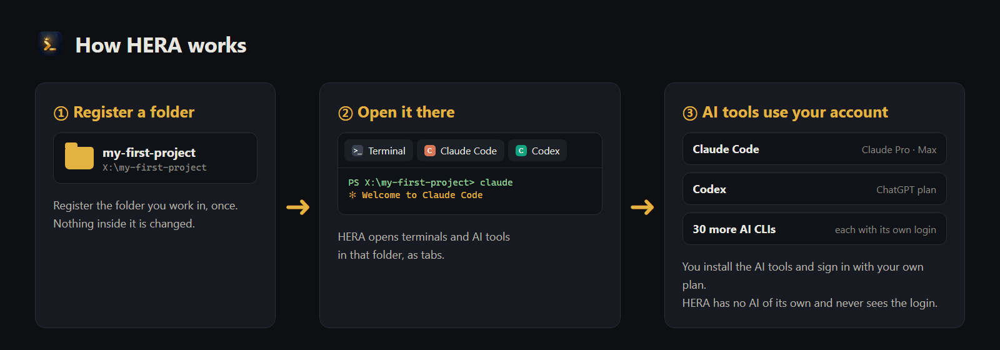
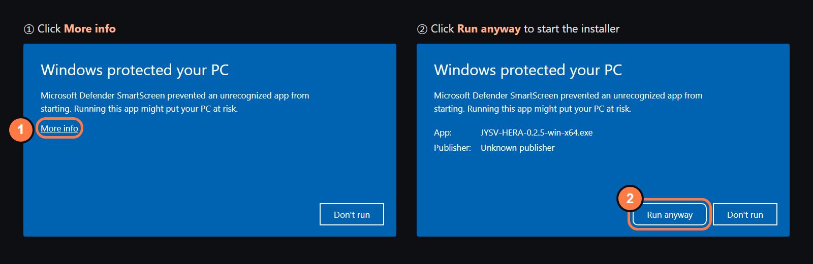
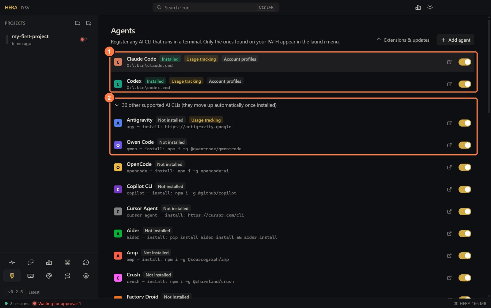
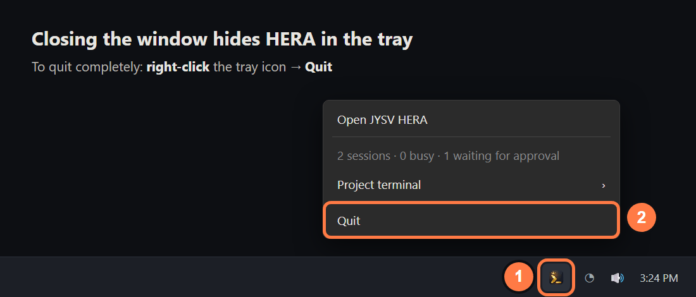
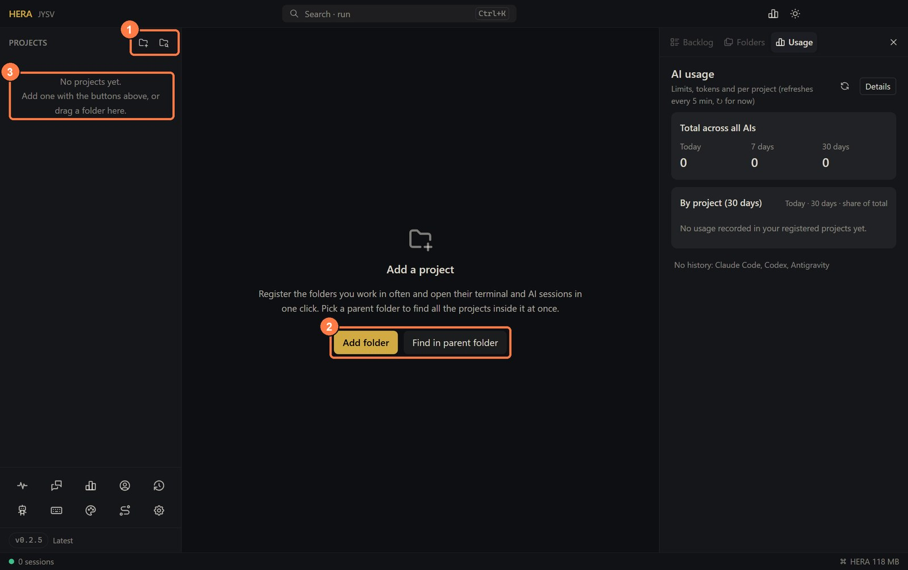
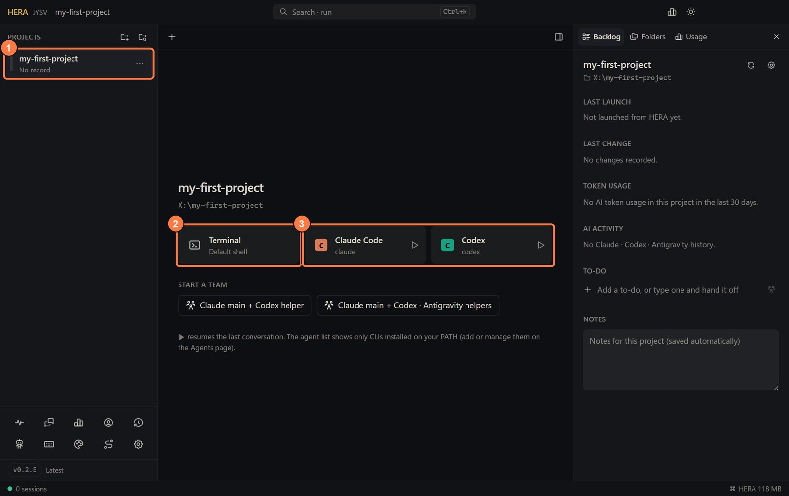
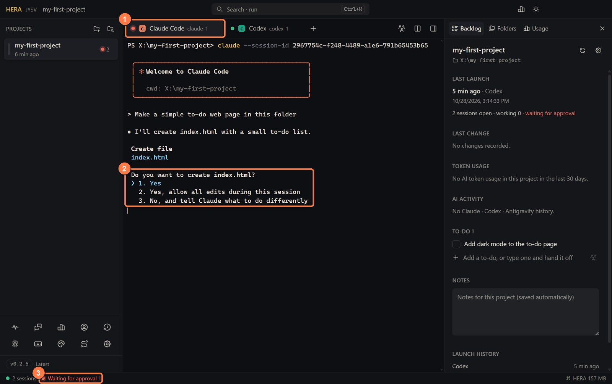
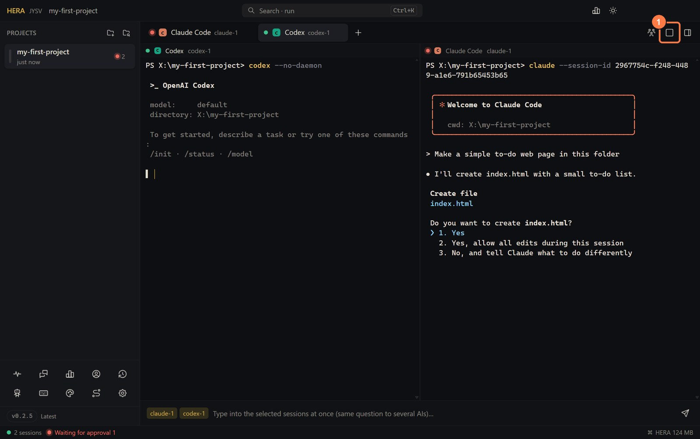
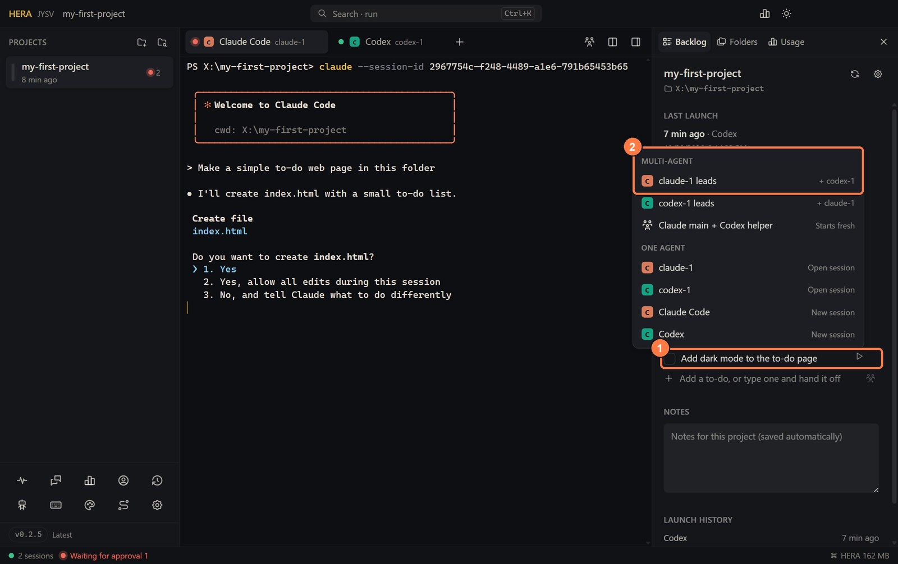

<!-- lang -->[한국어](../ko/getting-started.md) · [All docs](README.md) · [README](../../README.md)

# Getting started

New to terminals or AI coding tools? This page takes you from the download to your first AI conversation, one step at a time, with pictures. It takes about ten minutes.

## How HERA works

A terminal is a window where you type commands as text. HERA has no AI of its own. It is a window that opens terminals, and the AI tools you install (Claude Code, Codex and others) run inside those terminals. Every terminal belongs to a **project**: a folder on your computer that you register once. That is why nothing opens until you have registered a folder.

## 1. Install HERA

Download the file for your computer from [Releases](https://github.com/jysvai/JYSV-HERA/releases/latest) and install it. On Windows, take `…-win-x64.exe`. On a Mac, open the Apple menu → *About This Mac*: with an Apple chip (M1, M2 …) take `…-mac-arm64.dmg`, with Intel take `…-mac-x64.dmg`. Linux and more details are in the [Install](../../README.md#install) table.

**Windows:** the app is not code-signed yet, so a blue "Windows protected your PC" window may appear. No administrator rights are needed.

**macOS:** open the `.dmg` and drag HERA to Applications. macOS blocks the first launch. On macOS 15 and later, go to *System Settings → Privacy & Security* and press **Open Anyway**. On macOS 13–14, right-click the app and choose *Open*.

The window follows your computer's language (Korean or English). To change it, open the gear icon at the bottom of the sidebar (*Settings*) → *언어 · Language* → *화면 언어 · Display language*.

## 2. Install at least one AI tool

HERA finds AI tools that are already installed on your computer. Install one now; you can add more later.

| AI | Install (paste into a terminal) | Account you need |
|---|---|---|
| [Claude Code](https://claude.com/claude-code) | `npm i -g @anthropic-ai/claude-code` | Claude Pro or Max, or an API key |
| [Codex](https://github.com/openai/codex) | `npm i -g @openai/codex` | A ChatGPT plan, or an API key |

- **Opening a terminal:** on Windows, press the Start key, type `PowerShell` and press Enter. On macOS, press Cmd+Space, type `Terminal` and press Enter. Paste the command (Windows: right-click or Ctrl+V, macOS: Cmd+V) and press Enter. After step 3 you can also use a HERA terminal.
- Check that it worked with `claude --version` (or `codex --version`). A version number means it is installed.
- `npm` comes with [Node.js](https://nodejs.org/). If `npm` is not found, install the Node.js **LTS** version, then **close the terminal window and open a new one**: only a new window sees `npm`.
- If Windows PowerShell says *running scripts is disabled on this system*, type `npm.cmd` instead of `npm`, for example `npm.cmd i -g @anthropic-ai/claude-code`. HERA terminals do not have this problem.
- If macOS reports an `EACCES` permission error, Claude Code can be installed with its official script instead: `curl -fsSL https://claude.ai/install.sh | bash`

HERA knows 32 AI tools. The **Agents** page (the robot icon at the bottom left) lists each one with its install command.

1. Installed tools are at the top, marked **Installed**.
2. Click the arrow to open this list and see the install command of every tool you do not have yet (it is open in the picture).

**After installing, quit HERA completely and start it again.** HERA looks for installed tools only when it starts, so it only sees tools installed before that. Closing the window does not quit HERA: it keeps running in the tray, next to the clock.

The picture shows Windows. On macOS, click the HERA icon in the menu bar at the top of the screen and choose *Quit*.

## 3. Register a project folder

A project is simply a folder where your work lives. If you do not have one yet, make an empty folder, for example `Documents/my-first-project`.

The first time you start HERA, you see this screen. Use whichever way you like:

1. The two small folder icons at the very top of the sidebar: **Add folder** on the left, **Find projects in a parent folder** on the right (hover to see the names).
2. The same two buttons in the middle. **Find in parent folder** scans a folder such as `Desktop` and lists the projects inside.
3. Drag a folder from Explorer or Finder onto this spot.

**Add folder** opens a folder picker: choose the folder and press *Select Folder* (*Open* on macOS). The folder appears in the sidebar. HERA only remembers where it is; nothing inside the folder changes.

## 4. Open a terminal or an AI

Click the project in the sidebar to see its start screen.

1. The project you registered. A click opens this screen; a double-click opens a terminal right away.
2. **Terminal**: an ordinary command line in that folder.
3. One card per installed AI. Click it to start that AI in the folder. The ▶ on a card continues that AI's last conversation.

If the card for your AI is missing, HERA cannot see it yet. Go back to step 2 and restart HERA.

## 5. The first time an AI starts

Each AI tool asks a few things once:

- **Sign in.** Claude Code and Codex open your browser so you can log in. Use the account you pay for, for example Claude Max or ChatGPT Plus. The login belongs to the AI tool; HERA never sees it.
- **Trusting the folder.** The AI asks whether it may read and change files in this folder, for example *Do you trust the files in this folder?* (the wording differs between tools and versions). Answer *Yes* for your own project.
- Then click inside the terminal once and type what you want in plain words, for example *"Make a simple to-do web page in this folder"*, and press Enter.

When the AI needs your permission, for example to run a command or change a file, HERA tells you.

1. A tab that waits for your approval gets a red dot. Green means it is waiting for your next instruction, amber means it is working. The project in the sidebar shows the same dot, and the number next to it is how many sessions are open.
2. The AI's question. Read it, type the number of your answer and press Enter (or choose with the arrow keys and press Enter).
3. The status bar counts the sessions waiting for approval. HERA can also send a notification.

The Claude Code screen in the picture is an example; the real one differs a little between versions.

## 6. Next steps

**Several AIs at once.** Start another AI with the **+** next to the tabs, then press the split button to see them side by side (up to four).

1. The split button. Hovering it shows *Split view (up to 4)*, or *Single view* while split. Press it again to go back to one pane.

**Let the AIs share the work.** In the **Backlog** panel on the right, type a to-do in the *Add a to-do* box and press Enter. Hover the to-do and press its ▶.

1. The to-do and its ▶ button.
2. **Multi-agent**: the AI you pick leads, hands parts of the task to the others and collects the results. See [Agents](agents.md#multi-agent-work-without-typing-hera).

Also:

- **Limits:** the *Usage* tab on the right shows how much of each AI's limits you have used. See [Usage](usage.md).
- **Closing:** closing the window keeps everything running in the tray, and after a reboot your tabs come back. See [Session memory](session-memory.md).

## If something does not work

| What you see | What to do |
|---|---|
| The screen only says "Add a project" and no terminal opens | Terminals open inside a project. Register a folder (step 3), then click it in the sidebar. |
| There is no card for Claude Code (or another AI) | It is not installed, or it was installed after HERA started. Install it (step 2), quit HERA from the tray and start it again. |
| Typing `claude` in a HERA terminal says it is not recognized | Same cause: quit HERA from the tray and start it again. To check where the tool is, type `where claude` (Windows) or `which claude` (macOS, Linux) in a HERA terminal. |
| `npm` is not recognized | Node.js is not installed. Install the LTS version from [nodejs.org](https://nodejs.org/), then close the terminal window and HERA, and open them again. |
| PowerShell says *running scripts is disabled on this system* | Type `npm.cmd` instead of `npm`, for example `npm.cmd i -g @openai/codex`. HERA terminals do not show this error. |
| The AI asks you to log in every time | Finish the browser login once. For Codex, see [Troubleshooting](troubleshooting.md#codex-asks-me-to-sign-in-again-after-hera-restarts). |

More fixes: [Troubleshooting](troubleshooting.md).
