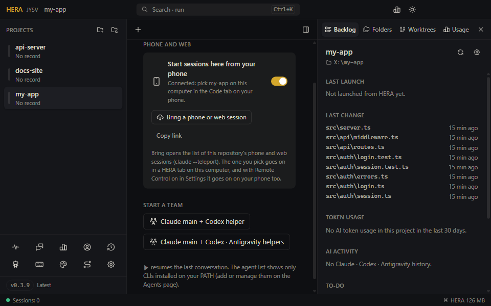

<!-- lang -->[한국어](../ko/remote-control.md) · [All docs](README.md) · [README](../../README.md)

# Phone and web (Remote Control)

Claude Code's Remote Control shows a Claude session that runs on your computer in the Claude app's **Code** tab and at [claude.ai/code](https://claude.ai/code). You can type on either side, and the conversation goes on in the same session. HERA uses it both ways:

- **Computer → phone**: the Claude tabs HERA opens also show on your phone.
- **Phone → computer**: start a session from your phone in a project folder on this computer, and continue it later in a HERA tab.

Remote Control needs a Claude account with a subscription (Pro, Max, Team or Enterprise), signed in with `/login`. It does not work with an API key, Bedrock, Vertex or a custom `ANTHROPIC_BASE_URL`. The computer has to stay on and HERA has to keep running, since Claude runs here and the phone only shows the session.

## Computer → phone: Claude tabs on your phone

Turn on *Settings → Terminal → Continue Claude on your phone and the web (Remote Control)*. From then on, HERA starts its Claude tabs with `--remote-control`, including the ones it resumes (▶).

- The session shows in the Code tab under the project's name until it gets a title of its own.
- Type in the terminal or on the phone: both see the whole conversation.
- Helper agents of a team and lanes are left out, so the phone list holds only the sessions you lead.
- The setting is read each time a Claude tab starts. A tab that is already running keeps what it started with until it starts again (▶, or when HERA restores it); type `/remote-control` in it to turn it on right away.

Claude Code can also turn Remote Control on by itself (`remoteControlAtStartup`, or a default Anthropic rolls out). That default changes over time and does not reach every account, which is why sessions can stop showing up on the phone without anything changing on your side. Asking for it on the command line does not depend on that default.

## Phone → computer: start sessions here from your phone

On a project's start screen, under **Phone and web**, switch on **Start sessions here from your phone**. HERA then keeps a `claude remote-control` server running in that folder while HERA runs. The status line says **Connected** once it is ready.

On your phone, open the Claude app, tap **Code**, and pick this computer's folder (the status line names it as the phone lists it) to start a new session. It runs on this computer in the project folder. **Copy link** copies the claude.ai/code link for the folder.

- Each project has its own switch. A server costs little until a session starts.
- A server stops by itself after about 10 minutes without a network, and a Claude Code update can stop it too. HERA starts it again, and keeps trying every 10 minutes for a server that was connected before.
- HERA stops the servers with Ctrl+C when it quits, so the folder is free again right away. If a server was stopped some other way (a crash), Anthropic keeps the folder taken for up to about 10 minutes ("already served by another Claude Code on this device"), and HERA tries again every 20 seconds until it is free.
- If the folder has a `claude remote-control` of your own running in a terminal, HERA's server waits for it to stop.

### ANTHROPIC_API_KEY

`claude remote-control` refuses to start whenever `ANTHROPIC_API_KEY` is set, even if you are signed in with claude.ai and told Claude Code not to use that key. When you are signed in with claude.ai, HERA leaves the variable out of the server's environment, so the server starts. The sessions you start from your phone run under that server, so they do not see it either. Your terminals keep it.

## Bring a phone or web session into a HERA tab

**Bring a phone or web session** (on the start screen, and in the **+** menu) opens a Claude tab with `claude --teleport`. It lists the sessions of this repository: the ones started from your phone through the server above, other Remote Control sessions, and cloud sessions. Pick one and it goes on in the tab on this computer. With Remote Control on in Settings, it stays reachable from your phone too.

Teleport works in a git repository whose GitHub remote matches the session's.

## If a session does not show up on the phone

- Check that you are signed in with claude.ai: `claude /login`, not an API key.
- Team and Enterprise: an admin can turn Remote Control off for the organization. `/remote-control` in a session says so.
- A server's error shows under the switch. **Try again** restarts it.
- A tab that was already running when you turned the setting on is not on the phone until it starts again. Type `/remote-control` in it, or restart it with ▶.
- A project folder that was moved or deleted shows "The project folder is missing" under the switch. **Try again** once it is back.
