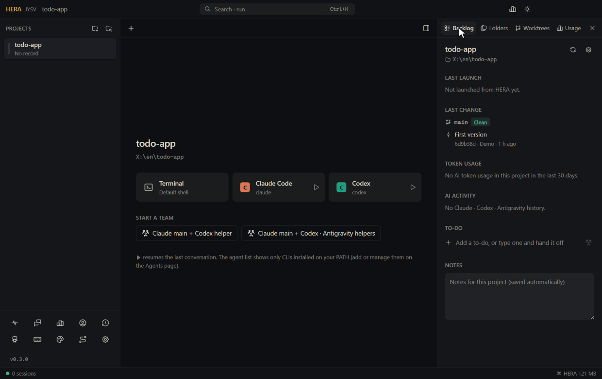
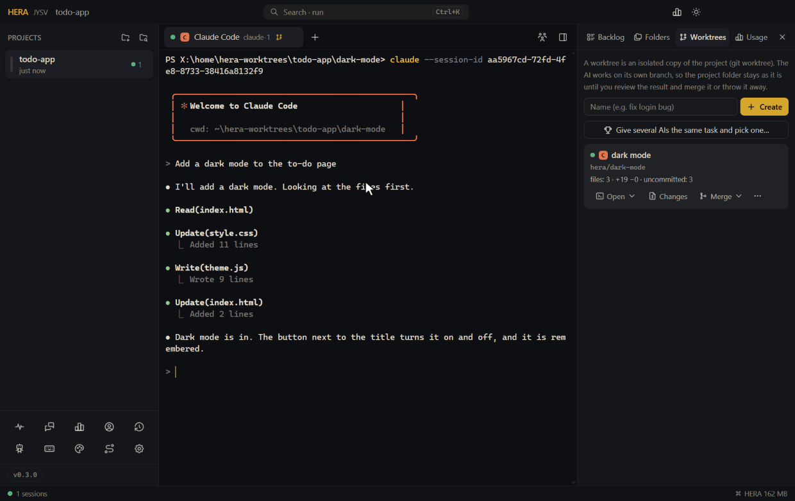
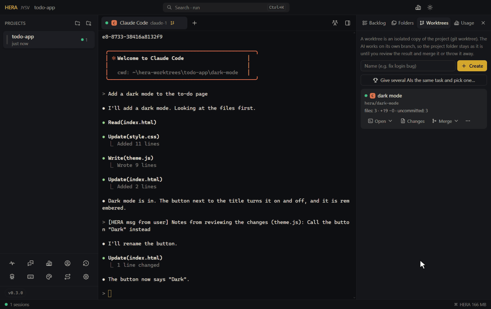
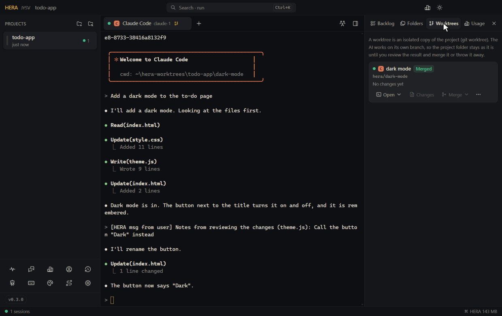

<!-- lang --><sub>[한국어](../ko/worktrees.md) · [All docs](README.md) · [README](../../README.md)</sub>

# Worktrees

A worktree is an isolated copy of your project. An AI works in it on a branch of its own, so the project folder does not change while it works. When it is done, you look at what changed and merge it into the project, or throw it away. Several AIs can each work in their own copy at the same time, even on the same files, without getting in each other's way.

HERA makes these copies with git (`git worktree`). Open the **Worktrees** tab (작업 공간) in the right-hand panel.

## What you need

- **git** on your computer.
- The project is a **git repository with at least one commit**. If it is not, the Worktrees tab says so and offers **Make it a git repository** (git 저장소로 만들기). That runs `git init` and saves the current files as the first commit. If the folder has no `.gitignore`, HERA first writes a basic one that leaves out `node_modules`, `.venv`, `.env` and the like.
- Projects that use a WSL shell are not supported yet.

If git says it does not know your name and email, run these once in any terminal and try again:

```
git config --global user.name "Your Name"
git config --global user.email "you@example.com"
```

## Make a worktree

In the Worktrees tab, type a name (for example *fix login bug*), press **Create** (만들기) and pick an AI or a terminal. HERA:

1. makes a branch `hera/<name>` from the commit your project folder is on now;
2. checks it out in `~/hera-worktrees/<project>/<name>`, outside your project;
3. copies the project's `.env` files into it (they are not in git, but the project usually needs them);
4. opens the AI or terminal there. Its tab shows a branch icon, and in split view the pane shows the branch.



Good to know:

- The copy starts from the **last commit**. Changes you have not committed in the project folder are not in it; the tab tells you how many there are.
- Dependencies such as `node_modules` are not copied. Set a **Setup command for new worktrees** in the project's settings (for example `npm install`) and HERA runs it in a terminal tab of every new worktree. Or ask the AI to install them.
- To copy more ignored files into every new worktree, list them in a `.worktreeinclude` file at the top of the repository: one path per line, no wildcards (the same file name and rules as Orca).
- The first time an AI starts in a new folder, it may ask whether to trust that folder.

## Review, merge, throw away

Each worktree is a card with its branch and what changed: files, `+added −deleted` lines, commits, and files not yet committed. The numbers update every few seconds.



- **Open** (열기): jump to a tab already working in it, or open a new terminal or AI there.
- **Changes** (변경 보기): every changed file against the starting commit, committed or not, new files included. Under it, write a note and press **Send**: it is typed into the worktree's AI, so you can ask for fixes without leaving the review.
- **Merge** (합치기) into the branch your project folder is on:
  - **Merge (merge commit)** keeps the copy's commits.
  - **Squash into one commit** brings the whole change in as one commit.
  - What the AI left uncommitted is committed in the copy first. If the AI is still working, HERA asks first, since files it is halfway through writing would go in too.
  - The project folder must be on a branch and have no uncommitted changes, so a failed merge can always be undone completely.
  - **If there is a conflict**, HERA undoes the merge and the project folder is exactly as it was. HERA offers to hand the conflict to the copy's AI: it runs `git merge` of your branch inside the copy, resolves the conflicts and commits. Then merge again.
  - You can keep using a worktree after a merge. The next merge brings in only what was done since, also after a squash: HERA then merges the project's branch into the worktree, so the worktree continues from the project's latest state.
- **⋯ → Commit the changes** saves what the AI left uncommitted as a commit on the copy's branch.
- **⋯ → Discard / Delete** removes the folder and its `hera/…` branch. HERA counts again, right then, how many uncommitted files and unmerged commits would be lost, tells you, and closes the tabs working in it. Commits on the branch are counted even if you deleted the folder by hand.



HERA only ever deletes worktrees and `hera/…` branches it made itself. Copies you deleted by hand disappear from the list on the next start. A tab whose worktree folder is gone reopens as a terminal in the project folder, without the AI, and says so.

## Give several AIs the same task and pick one

**Give several AIs the same task and pick one…** (여러 AI 에게 같은 일 시키고 고르기) is in the Worktrees tab and in the backlog's ▶ menu.

1. Write the task and pick 2 to 4 AIs (the same AI twice is fine).
2. HERA makes one worktree per AI, opens them side by side and types the task into each one as soon as it is ready.
3. The cards appear together under **Compare: …**. Look at each one's changes; send notes if one needs a fix.
4. Press **Keep this one** (이걸로 고르기) on the best result. HERA merges it as one commit and offers to delete the comparison's worktrees.



Each AI uses its own quota, so a comparison costs as many runs as AIs. If starting any of them fails, HERA takes back the worktrees and tabs it made.

## Helpers in their own worktrees

In multi-agent work (the backlog's ▶ menu, or the team button in the tab bar), switch on **Helpers work in their own worktrees** (보조는 각자 작업 공간에서). New helpers then open in worktrees of their own, and the lead's briefing says where each helper works and on which branch, and that it should check a helper's result with `git diff` and bring it in with `git merge hera/<name>`. The lead stays in the project folder.

Agents can do the same themselves with the [`hera` CLI](hera-cli.md):

```
hera spawn codex --worktree            # a helper in its own worktree (branch hera/codex)
hera spawn claude --worktree=refactor  # with a name
hera worktrees                         # this project's worktrees: branch, folder, tabs
```

## Where things are

- Worktrees: `~/hera-worktrees/<project>/<name>` (set the `HERA_WORKTREES` environment variable before starting HERA to use another folder).
- The list HERA keeps: `worktrees.json` in HERA's data folder.
- Usage in a worktree counts toward its project on the Usage page.

## See also

- [Agents](agents.md#multi-agent-work-without-typing-hera) for multi-agent work.
- [The hera CLI](hera-cli.md).
