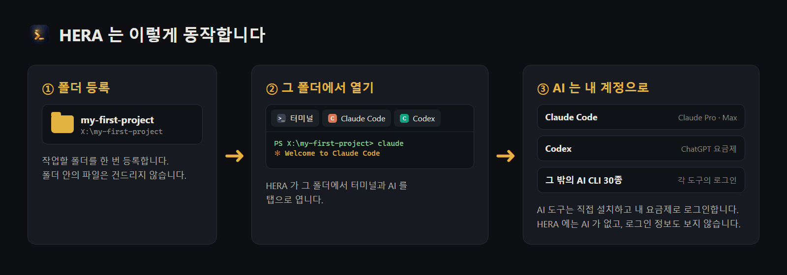
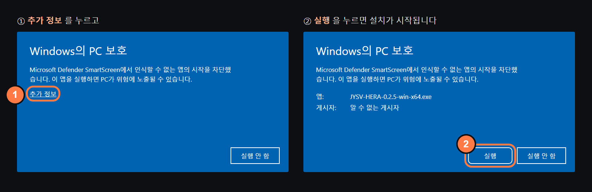
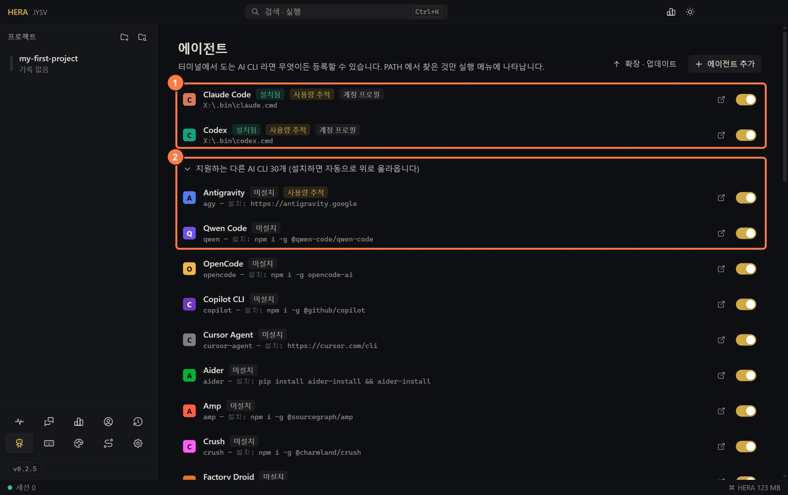
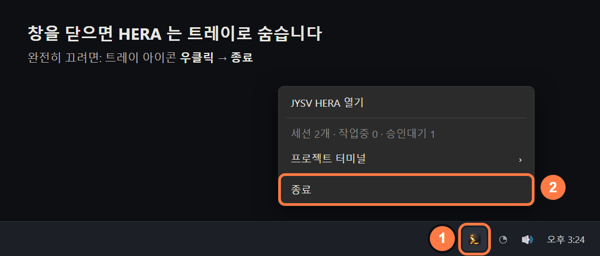
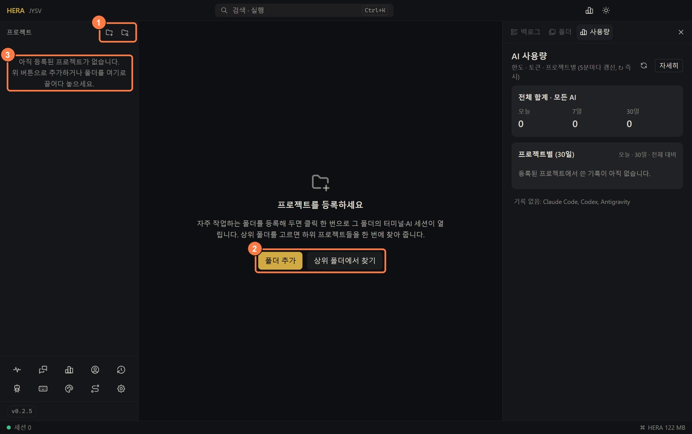
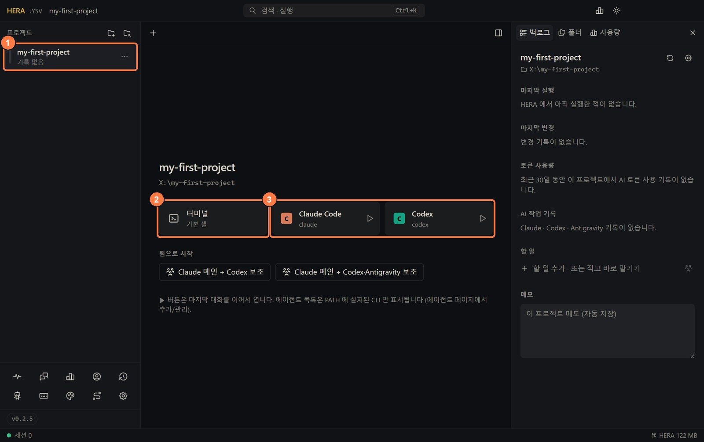
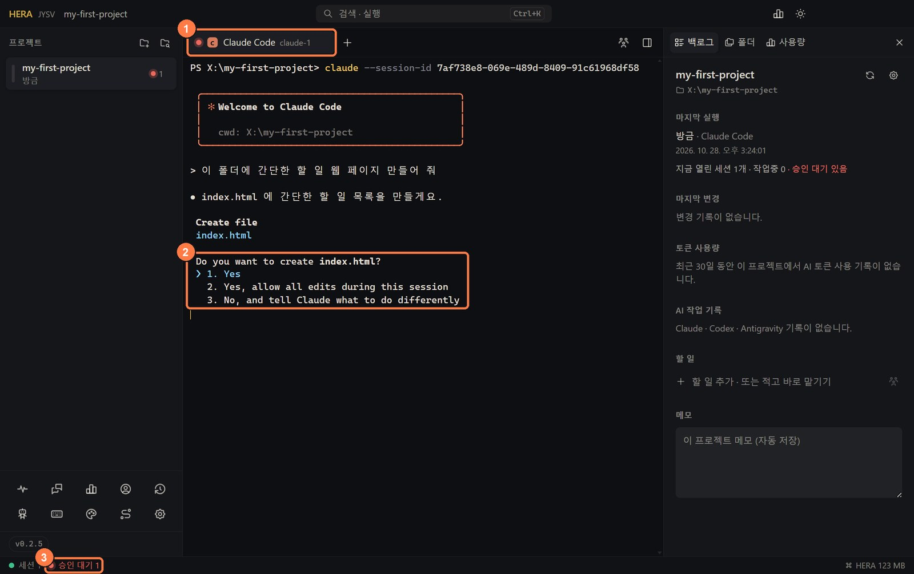
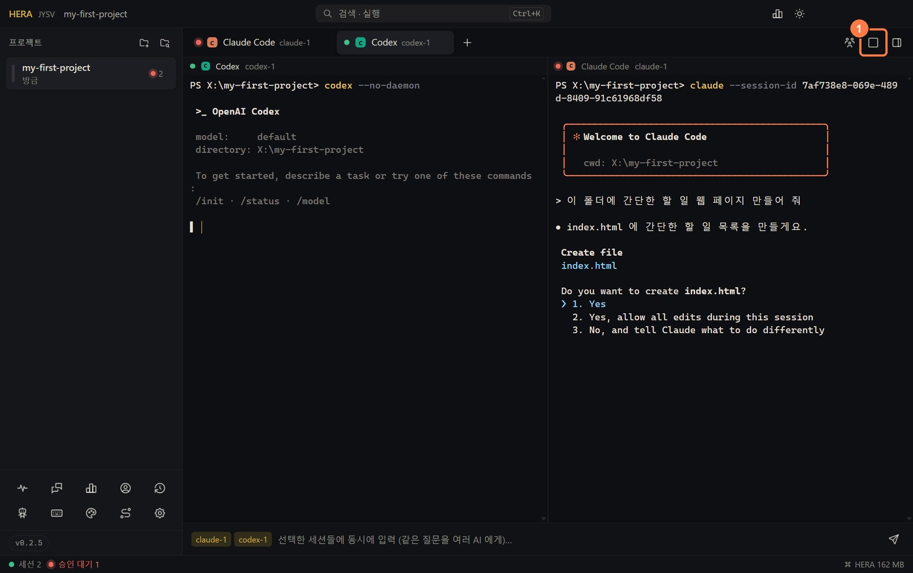
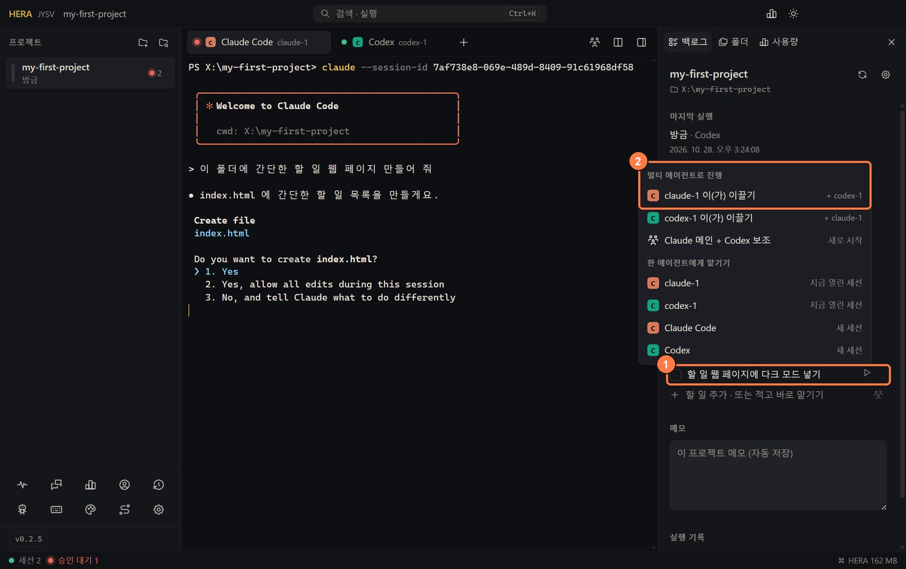

<!-- lang -->[English](../en/getting-started.md) · [전체 문서](README.md) · [README](../../README.ko.md)

# 처음 시작하기

터미널이나 AI 코딩 도구가 처음이신가요? 이 페이지는 설치 파일을 받는 것부터 AI 와 첫 대화를 하기까지 그림과 함께 한 단계씩 안내합니다. 10분 정도 걸립니다.

## HERA 가 동작하는 방식

터미널은 명령을 글자로 입력해서 실행하는 창입니다. HERA 에는 자체 AI 가 없습니다. HERA 는 터미널을 여는 창이고, 직접 설치한 AI 도구(Claude Code, Codex 등)가 그 터미널 안에서 돌아갑니다. 모든 터미널은 **프로젝트**에 속합니다. 프로젝트는 한 번 등록해 두는 내 컴퓨터의 폴더입니다. 그래서 폴더를 등록하기 전에는 아무것도 열리지 않습니다.

## 1. HERA 설치

[Releases](https://github.com/jysvai/JYSV-HERA/releases/latest) 에서 내 컴퓨터에 맞는 파일을 받아 설치하세요. Windows 는 `…-win-x64.exe` 를 받으세요. Mac 은 Apple 메뉴 → *이 Mac에 관하여* 에서 칩이 Apple(M1, M2 …)이면 `…-mac-arm64.dmg`, Intel 이면 `…-mac-x64.dmg` 입니다. Linux 와 자세한 내용은 [설치](../../README.ko.md#설치) 표에 있습니다.

**Windows:** 아직 코드 서명이 없어서 파란색 "Windows의 PC 보호" 창이 뜰 수 있습니다. 관리자 권한은 필요 없습니다.

**macOS:** `.dmg` 를 열고 HERA 를 응용 프로그램 폴더로 끌어다 놓으세요. 처음 실행은 macOS 가 막습니다. macOS 15 이상은 *시스템 설정 → 개인정보 보호 및 보안* 에서 **그래도 열기** 를 누르세요. macOS 13–14 는 앱을 우클릭한 뒤 *열기* 를 고르세요.

화면 언어는 컴퓨터 언어(한국어 또는 영어)를 따릅니다. 바꾸려면 사이드바 아래쪽의 톱니바퀴(*설정*) → *언어 · Language* → *화면 언어 · Display language* 에서 고르세요.

## 2. AI 도구 하나 이상 설치

HERA 는 컴퓨터에 이미 설치된 AI 도구를 찾아서 보여 줍니다. 지금 하나를 설치하세요. 나머지는 나중에 더해도 됩니다.

| AI | 설치 (터미널에 붙여 넣기) | 필요한 계정 |
|---|---|---|
| [Claude Code](https://claude.com/claude-code) | `npm i -g @anthropic-ai/claude-code` | Claude Pro 또는 Max, 또는 API 키 |
| [Codex](https://github.com/openai/codex) | `npm i -g @openai/codex` | ChatGPT 요금제, 또는 API 키 |

- **터미널 여는 법:** Windows 는 시작 키를 누르고 `PowerShell` 을 입력한 뒤 Enter. macOS 는 Cmd+Space 를 누르고 `터미널` 을 입력한 뒤 Enter. 명령을 붙여 넣고(Windows: 우클릭 또는 Ctrl+V, macOS: Cmd+V) Enter 를 누르면 설치됩니다. 3단계를 마친 뒤에는 HERA 터미널에서 해도 됩니다.
- 설치가 끝났는지는 `claude --version` (또는 `codex --version`) 으로 확인합니다. 버전 번호가 나오면 성공입니다.
- `npm` 은 [Node.js](https://nodejs.org/) 를 설치하면 같이 깔립니다. `npm` 을 찾을 수 없다고 나오면 Node.js **LTS** 버전을 설치한 뒤, **열려 있던 터미널 창을 닫고 새로 여세요.** 새 창에서만 `npm` 이 보입니다.
- Windows PowerShell 에서 *이 시스템에서 스크립트를 실행할 수 없으므로…* 라는 오류가 나면 `npm` 대신 `npm.cmd` 로 치세요. 예: `npm.cmd i -g @anthropic-ai/claude-code`. HERA 터미널에서는 이 오류가 나지 않습니다.
- macOS 에서 `EACCES` 권한 오류가 나면 Claude Code 는 공식 설치 스크립트로 설치할 수 있습니다: `curl -fsSL https://claude.ai/install.sh | bash`

HERA 가 아는 AI 도구 32종과 각각의 설치 명령은 왼쪽 아래 **에이전트** 페이지(로봇 아이콘)에 있습니다.

1. 설치된 AI 는 **설치됨** 표시와 함께 맨 위에 나옵니다.
2. 아직 없는 AI 는 화살표를 눌러 이 목록을 펼치면 설치 명령이 보입니다(그림은 펼친 상태입니다).

**설치한 뒤에는 HERA 를 완전히 종료했다가 다시 켜세요.** HERA 는 켜질 때만 설치된 도구를 찾기 때문에, 그 뒤에 설치한 도구는 다시 켜야 보입니다. 창을 닫으면 HERA 는 꺼지지 않고 트레이(시계 옆)로 숨기만 합니다.

그림은 Windows 입니다. macOS 는 화면 위 메뉴 막대의 HERA 아이콘을 눌러 *종료* 를 고르세요.

## 3. 프로젝트 폴더 등록

프로젝트는 그냥 작업할 파일을 두는 폴더입니다. 아직 없다면 빈 폴더를 하나 만드세요. 예: `문서/my-first-project`

처음 켜면 이런 화면이 나옵니다. 세 가지 방법 중 편한 것을 쓰세요.

1. 사이드바 맨 위의 작은 폴더 아이콘 두 개. 왼쪽이 **폴더 추가**, 오른쪽이 **상위 폴더에서 프로젝트 찾기** 입니다(마우스를 올리면 이름이 나옵니다).
2. 가운데의 같은 두 버튼. **상위 폴더에서 찾기** 는 `바탕화면` 같은 폴더를 고르면 그 안의 프로젝트를 찾아 줍니다.
3. 탐색기나 Finder 에서 폴더를 이 자리로 끌어다 놓기

**폴더 추가** 를 누르면 폴더를 고르는 창이 열립니다. 폴더를 고르고 *폴더 선택*(macOS 는 *열기*)을 누르세요. 사이드바에 폴더가 나타납니다. HERA 는 폴더 위치만 기억하고, 폴더 안의 파일은 건드리지 않습니다.

## 4. 터미널이나 AI 열기

사이드바에서 프로젝트를 누르면 시작 화면이 나옵니다.

1. 등록한 프로젝트. 누르면 이 화면이 열리고, 두 번 누르면 바로 터미널이 열립니다.
2. **터미널**: 그 폴더에서 여는 일반 명령줄
3. 설치된 AI 마다 하나씩 있는 카드. 누르면 그 폴더에서 AI 가 시작됩니다. 카드의 ▶ 는 그 AI 의 마지막 대화를 이어서 엽니다.

쓰려는 AI 카드가 없다면 HERA 가 아직 그 도구를 못 찾은 것입니다. 2단계로 돌아가서 HERA 를 다시 켜세요.

## 5. AI 를 처음 실행할 때

AI 도구는 처음 한 번 몇 가지를 묻습니다.

- **로그인.** Claude Code 와 Codex 는 브라우저를 열어 로그인하게 합니다. 구독 중인 계정(예: Claude Max, ChatGPT Plus)으로 로그인하세요. 로그인 정보는 AI 도구가 가지고 있고, HERA 는 보지 않습니다.
- **폴더 신뢰 확인.** AI 가 이 폴더의 파일을 읽고 바꿔도 되는지 영어로 묻습니다(예: *Do you trust the files in this folder?* 문구는 도구와 버전마다 다릅니다). 내 프로젝트라면 *Yes* 를 고르세요.
- 그다음 터미널 안을 한 번 누르고, 하고 싶은 일을 평소 말투로 적은 뒤 Enter 를 누르세요. 예: *"이 폴더에 간단한 할 일 웹 페이지 만들어 줘"*

AI 가 명령 실행이나 파일 수정 같은 허락을 구하면 HERA 가 알려 줍니다.

1. 허락을 기다리는 탭에는 빨간 점이 붙습니다. 초록 점은 다음 지시를 기다리는 중, 노란 점은 일하는 중이라는 뜻입니다. 사이드바의 프로젝트에도 같은 점이 보이고, 옆의 숫자는 열려 있는 세션 수입니다.
2. AI 의 질문입니다. 읽어 보고 원하는 답의 번호를 입력한 뒤 Enter 를 누르세요(방향키로 고르고 Enter 를 눌러도 됩니다).
3. 아래 상태줄에 승인을 기다리는 세션 수가 나옵니다. 설정에 따라 알림도 옵니다.

그림 속 Claude Code 화면은 예시이고, 실제 화면은 버전에 따라 조금 다릅니다.

## 6. 다음 단계

**AI 여러 개 같이 쓰기.** 탭 옆의 **+** 로 AI 를 하나 더 연 뒤, 분할 버튼을 누르면 나란히 보입니다(최대 4개).

1. 분할 버튼. 마우스를 올리면 *분할 보기 (최대 4개)*, 분할 중에는 *한 화면 보기* 라고 나옵니다. 다시 누르면 한 화면으로 돌아갑니다.

**AI 끼리 일 나누게 하기.** 오른쪽 **백로그** 패널의 *할 일 추가* 칸에 할 일을 적고 Enter 를 누르세요. 그 할 일에 마우스를 올리면 나오는 ▶ 를 누릅니다.

1. 할 일과 ▶ 버튼
2. **멀티 에이전트로 진행**: 고른 AI 가 리드를 맡고, 나머지 AI 에게 일을 나눠 맡긴 뒤 결과를 모읍니다. 자세한 내용은 [에이전트](agents.md#hera-를-치지-않는-멀티-에이전트-작업) 에 있습니다.

그 밖에:

- **한도 보기:** 오른쪽 *사용량* 탭에 AI 별로 한도를 얼마나 썼는지 나옵니다. [사용량](usage.md) 참고.
- **닫기:** 창을 닫아도 트레이에서 모두 계속 돌고, 재부팅해도 탭이 돌아옵니다. [세션 기억](session-memory.md) 참고.

## 잘 안 될 때

| 보이는 것 | 해결 |
|---|---|
| 화면에 "프로젝트를 등록하세요" 만 나오고 터미널이 안 열림 | 터미널은 프로젝트 안에서 열립니다. 폴더를 등록하고(3단계) 사이드바에서 누르세요. |
| Claude Code (또는 다른 AI) 카드가 없음 | 설치가 안 됐거나, HERA 를 켠 뒤에 설치했습니다. 설치하고(2단계) 트레이에서 HERA 를 종료한 뒤 다시 켜세요. |
| HERA 터미널에서 `claude` 를 치면 찾을 수 없다고 나옴 | 원인이 같습니다. 트레이에서 HERA 를 종료하고 다시 켜세요. 도구가 어디 있는지는 HERA 터미널에 `where claude` (Windows) 나 `which claude` (macOS, Linux) 를 쳐서 확인합니다. |
| `npm` 을 찾을 수 없다고 나옴 | Node.js 가 없습니다. [nodejs.org](https://nodejs.org/) 에서 LTS 버전을 설치한 뒤, 터미널 창과 HERA 를 모두 닫았다가 다시 여세요. |
| PowerShell 에서 *스크립트를 실행할 수 없으므로* 오류 | `npm` 대신 `npm.cmd` 로 치세요(예: `npm.cmd i -g @openai/codex`). HERA 터미널에서는 나지 않습니다. |
| AI 가 매번 로그인하라고 함 | 브라우저 로그인을 한 번 끝까지 마치세요. Codex 는 [문제 해결](troubleshooting.md#hera-를-재시작하면-codex-가-다시-로그인하라고-할-때) 을 보세요. |

다른 문제: [문제 해결](troubleshooting.md)
