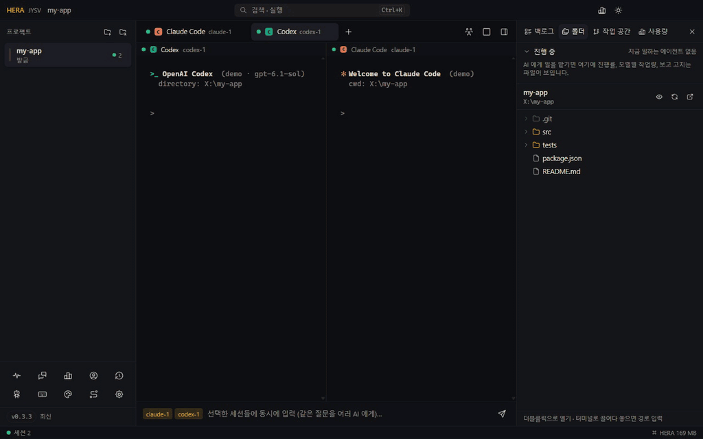
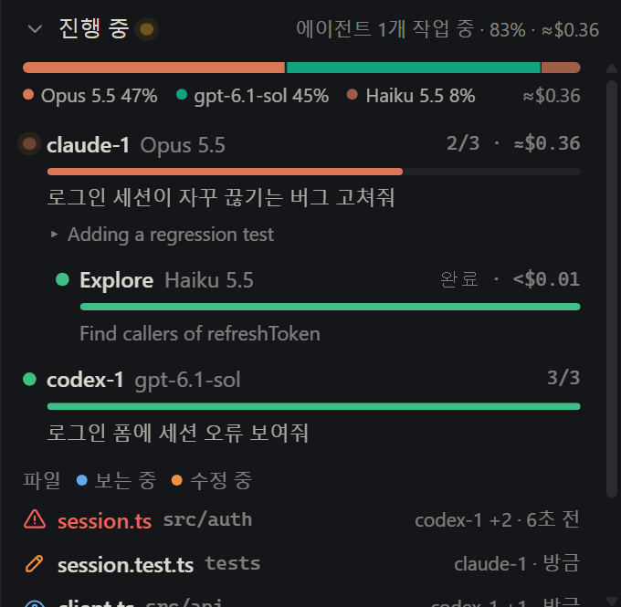
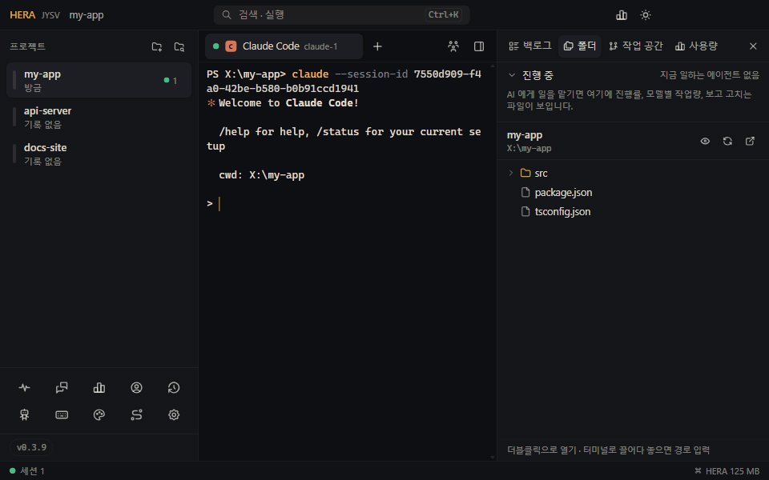

<!-- lang -->[English](../en/live-activity.md) · [전체 문서](README.md) · [README](../../README.ko.md)

# 실시간 작업 현황

프로젝트에서 AI 가 일하는 동안 **폴더** 탭 맨 위에 지금 무슨 일이 일어나는지 보입니다. 에이전트마다 얼마나 진행했는지, 모델별로 얼마만큼 일했는지, API 가격으로 치면 얼마인지, 그리고 지금 어떤 파일을 어느 에이전트가 보고 고치는지를 터미널을 하나하나 읽지 않고 한눈에 볼 수 있습니다.

## 어디에 있나

오른쪽 패널의 **폴더** 탭(`Ctrl+Shift+E`, macOS `⌘E`)을 여세요. 폴더 트리 위에 **진행 중** 영역이 있고, 제목을 누르면 접힙니다. 프로젝트의 에이전트가 일하는 동안에는 패널에서 다른 탭을 보고 있어도 폴더 탭 옆에 점이 찍힙니다.

따로 켤 것은 없습니다. 일하는 에이전트가 없으면 한 줄만 보입니다.

## 무엇이 보이나

### 모델별 작업량

맨 위 막대는 지금 작업을 모델별로 나눕니다. 프로젝트의 모든 에이전트와 그들이 띄운 서브에이전트가 만들어 낸(생성한) 토큰 가운데 각 모델의 몫입니다. 아래에 모델 이름과 비율이 나옵니다. 같은 에이전트의 모델은 그 에이전트 색을 옅게 나눠 씁니다. 예를 들어 Opus 와, Opus 가 띄운 Haiku 서브에이전트.

오른쪽 금액은 Claude 모델의 API 정가로 계산한 추정치입니다. 구독 요금제라면 이렇게 청구되지 않고, 작업이 얼마나 무거운지 가늠하는 용도입니다. Codex 와 다른 모델은 비용을 표시하지 않습니다.

### 에이전트마다 한 줄

- **이름과 모델**: 탭 이름(`claude-1`, `codex-1`, `lane mid`)과 일을 가장 많이 한 모델. 누르면 그 탭으로 갑니다.
- **진행 막대**: 에이전트가 스스로 만든 할 일 목록(Claude Code 의 작업 목록)이나 계획(Codex 의 plan)으로 계산합니다. 둘 다 없고 서브에이전트를 띄웠다면 그중 몇 개가 끝났는지를 셉니다. 그것도 없으면 일하는 동안 숫자 없이 움직이기만 합니다. HERA 는 퍼센트를 지어내지 않습니다. 끝난 작업은 초록색이 됩니다.
- **오른쪽**: 전체 단계 중 끝난 단계, 또는 *작업 중*, *응답 기다림*(에이전트가 승인을 묻는 중), *완료*, 그리고 예상 비용.
- **막대 아래**: 맡긴 요청, 그리고 ▸ 지금 하는 단계.
- Claude Code 가 띄운 **서브에이전트**(Explore, 리뷰어 등)는 그 아래에 종류 · 모델 · 맡은 일과 함께 나오고, 끝나면 *완료* 로 바뀝니다.

줄에 마우스를 올리면 그 작업의 도구 호출 수, 수정한 파일 수, 토큰이 나옵니다. 새 요청을 하면 새 작업이 시작되어 숫자도 0 부터 다시 셉니다. 끝난 작업은 30분 동안 남아 있습니다.

제목 줄에는 일하는 에이전트 수, 계획을 세운 에이전트들의 전체 진행률, 예상 비용이 요약됩니다.

### 파일

| 표시 | 뜻 | 남아 있는 시간 |
|---|---|---|
| 파란 눈 | **보는 중**: 에이전트가 파일을 열어 봄 | 읽은 뒤 90초 |
| 주황 연필 | **수정 중**: 에이전트가 파일을 바꿈 | 그 에이전트가 일하는 동안, 그리고 끝난 뒤 5분 |
| 빨간 경고 | **여러 에이전트가 함께 수정 중**: 서로 다른 두 에이전트가 지금 작업에서 같은 파일을 바꿈 | 수정 표시가 남아 있는 동안 |

파일마다 폴더, 더하고 지운 줄 수(<code>+12 −3</code>), 손대는 에이전트(`claude-1 +1` 은 한 명 더), 몇 초 전인지가 나옵니다. 보는 중인 파일을 누르면 폴더 트리가 그 파일로 열리고, 바뀐 파일을 누르면 무엇이 바뀌었는지(아래) 나옵니다. [작업 공간](worktrees.md) 복사본에 있는 파일에는 브랜치 아이콘이 붙고, 프로젝트 폴더를 보여 주는 트리에는 표시되지 않습니다.

폴더 트리에도 같은 파일이 표시됩니다. 파일은 이름 색과 배경으로, 닫힌 폴더는 그 안에 있으면 점으로.

빨간 파일은 두 에이전트가 같은 곳을 동시에 바꾸고 있다는 뜻이라 한쪽이 다른 쪽 작업을 덮어쓸 수 있습니다. 하나가 끝날 때까지 기다리거나, 두 번째 에이전트에게 [작업 공간](worktrees.md)으로 자기 복사본을 주세요.

### 무엇이 바뀌었고 어디에 영향이 있나

에이전트가 파일을 바꾸면 파일 목록 위에 **바뀐 파일** 카드가 나옵니다. 지금 작업에서 바뀐 파일 수와 더하고 지운 줄 수입니다. 카드(또는 바뀐 파일)를 누르면 세 칸이 열립니다.

- **바뀐 파일**: 보이는 작업이 바꾼 파일 전체(모든 에이전트), 최근 것부터. 새 파일은 더하기 아이콘, 지운 파일은 빼기 아이콘이 붙습니다.
- **바뀐 내용**: 고른 파일을 에이전트마다 어떻게 바꿨는지 줄 단위로(더한 줄 초록, 지운 줄 빨강), 에이전트 이름과 시각과 함께. **트리에서 보기** 와 **열기** 로 그 파일로 갑니다.
- **영향 범위**: 고른 파일을 import 하는 파일, 그 파일들을 거쳐 닿는 파일(세 단계까지), 그리고 관련 테스트. 그중 테스트 파일과, 파일 이름을 딴 테스트(`login.test.ts`, `test_login.py`)입니다. 누르면 폴더 트리가 그 파일로 열립니다.

아래 칸에 메모를 적어 그 파일을 마지막으로 바꾼 에이전트의 탭으로 보낼 수 있습니다. **확인 요청** 은 관련 테스트를 돌리고 이 파일을 쓰는 파일을 확인해 달라는 메모를 채워 줍니다.

바뀐 내용은 에이전트가 직접 남긴 수정에서 옵니다. Claude Code 의 수정 · 쓰기 도구(그 도구가 기록한 패치)와 Codex 의 패치(Codex 가 보낼 때 셉니다)입니다. 줄은 바꾼 만큼 세므로, 바꿨다가 되돌린 줄은 두 번 셉니다. 셸 명령이나 다른 프로그램으로 바뀐 파일, 노트북 수정은 목록에는 나오지만 내용은 나오지 않습니다. 다음 요청부터는 다음 작업으로 세므로, 카드는 지금 작업을 셉니다.

영향 범위는 대화상자를 열 때 import 문을 읽어서 찾습니다.

- TypeScript · JavaScript: 상대 경로, `import()` · `require`, `tsconfig.json` · `jsconfig.json` 의 `paths` 와 `baseUrl`(`extends` · `references` 로 이어진 설정, 모노레포에서는 파일마다 가장 가까운 설정), 그리고 `package.json` 이름으로 불러오는 워크스페이스 패키지.
- Python: 상대 · 패키지 import, 여러 줄에 걸친 것도.

주석 안의 import 는 건너뜁니다. 문자열에 이름을 넣어 불러오는 코드나 파일 이름을 적은 설정 파일은 보지 못합니다. 읽는 파일은 프로젝트의 소스 파일(`git ls-files`, 또는 `node_modules` · `dist` 등을 뺀 폴더)이고, 3만 개까지입니다.

## 정보는 어디서 오나

HERA 는 각 AI CLI 가 원래 컴퓨터에 남기는 대화 기록을 읽습니다. CLI 에 아무것도 설치하지 않고, 훅도 추가하지 않고, 네트워크로 아무것도 보내지 않습니다.

- **Claude Code**: `~/.claude/projects/<폴더>/<대화>.jsonl`, 그리고 그 옆에 있는 서브에이전트 기록. HERA 탭에서 도는 lanes 도 포함됩니다.
- **Codex**: `~/.codex/sessions/<연>/<월>/<일>/rollout-*.jsonl`.
- [계정 프로필](agents.md)을 쓰면 `~/.claude` · `~/.codex` 대신 그 프로필 폴더.

열려 있는 에이전트 탭의 기록만, 그것도 지난번 이후 새로 붙은 부분만 읽습니다(창이 보일 때 1.5초마다, 숨겨져 있으면 더 드물게). 긴 대화는 마지막 2 MB 부터 읽습니다.

파일은 이렇게 알아봅니다.

- Claude Code 의 읽기 · 수정 도구, Codex 의 패치;
- 파일을 읽는 셸 명령(`cat`, `head`, `sed -n`, `rg … 파일`, `Get-Content` 등)이나 쓰는 명령(`>`, `sed -i`, `tee`, `Set-Content` 등). 명령이 실행된 폴더를 기준으로 합니다.

에이전트가 다른 프로그램(스크립트, 포매터, `git checkout`)으로 바꾼 파일은 보이지 않습니다.

## 한계

- 다른 에이전트(Antigravity, Gemini CLI, opencode 등)는 아직 여기 나오지 않습니다.
- 퍼센트는 에이전트가 계획을 세웠거나 서브에이전트를 띄웠을 때만 나옵니다.
- 작업량은 생성한 토큰 기준이고, 걸린 시간이나 바뀐 줄 수가 아닙니다.
- 비용은 API 정가 기준 추정치입니다.
- 에이전트가 이미 긴 작업을 하던 중에 HERA 가 켜지면, HERA 가 읽은 시점부터 셉니다.
