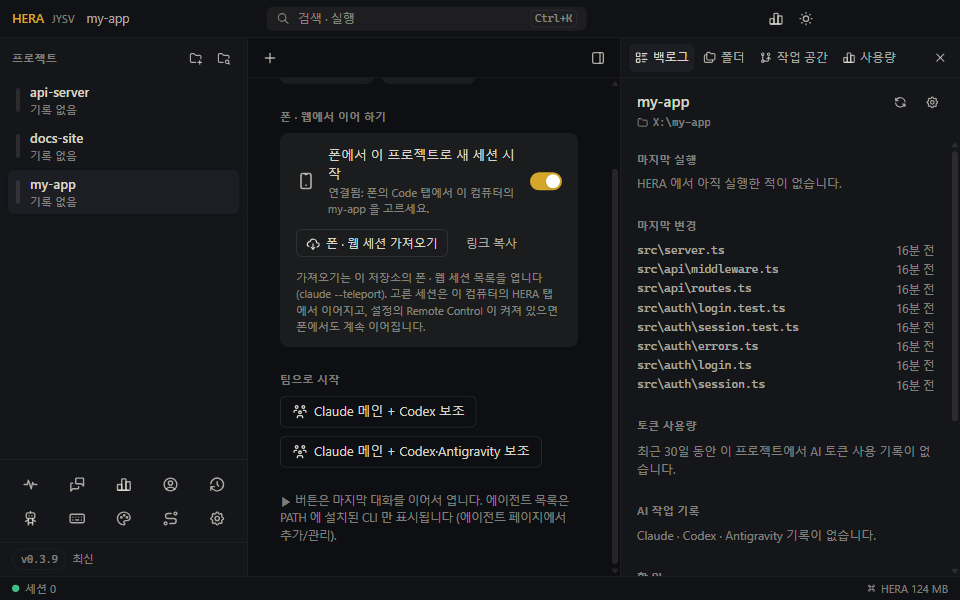

<!-- lang -->[English](../en/remote-control.md) · [전체 문서](README.md) · [README](../../README.ko.md)

# 폰 · 웹에서 이어 하기 (Remote Control)

Claude Code 의 Remote Control 은 내 컴퓨터에서 도는 Claude 세션을 Claude 앱의 **Code** 탭과 [claude.ai/code](https://claude.ai/code) 에 보여 줍니다. 어느 쪽에서 입력해도 같은 세션에서 대화가 이어집니다. HERA 는 이것을 양쪽으로 씁니다.

- **컴퓨터 → 폰**: HERA 가 여는 Claude 탭이 폰에도 뜹니다.
- **폰 → 컴퓨터**: 폰에서 이 컴퓨터의 프로젝트 폴더로 세션을 시작하고, 나중에 HERA 탭에서 이어 갑니다.

Remote Control 은 구독(Pro, Max, Team, Enterprise)이 있는 Claude 계정으로 `/login` 한 상태여야 합니다. API 키, Bedrock, Vertex, 직접 지정한 `ANTHROPIC_BASE_URL` 로는 동작하지 않습니다. Claude 는 이 컴퓨터에서 돌고 폰은 세션을 보여 주기만 하므로, 컴퓨터가 켜져 있고 HERA 가 실행 중이어야 합니다.

## 컴퓨터 → 폰: Claude 탭을 폰에서

*설정 → 터미널 → Claude 를 폰 · 웹에서도 이어 하기 (Remote Control)* 를 켜세요. 그다음부터 HERA 는 Claude 탭을 `--remote-control` 로 시작합니다. ▶ 로 이어 여는 탭도 마찬가지입니다.

- 세션은 제목이 생기기 전까지 Code 탭에 프로젝트 이름으로 보입니다.
- 터미널에서 입력하든 폰에서 입력하든 양쪽 모두 대화 전체를 봅니다.
- 팀의 보조 에이전트와 lanes 는 빠지므로, 폰 목록에는 내가 이끄는 세션만 남습니다.
- 설정은 Claude 탭이 시작될 때마다 읽습니다. 이미 실행 중인 탭은 다시 시작될 때까지(▶, 또는 HERA 가 복원할 때) 처음 상태를 유지합니다. 바로 켜려면 그 탭에서 `/remote-control` 을 입력하세요.

Claude Code 가 스스로 Remote Control 을 켜기도 합니다(`remoteControlAtStartup`, 또는 Anthropic 이 배포하는 기본값). 이 기본값은 바뀌기도 하고 모든 계정에 적용되지도 않아서, 내 쪽에서 바꾼 게 없는데 폰에 세션이 안 보이게 될 수 있습니다. 명령줄에서 직접 켜면 이 기본값과 상관없습니다.

## 폰 → 컴퓨터: 폰에서 이 프로젝트로 세션 시작

프로젝트 시작 화면의 **폰 · 웹에서 이어 하기** 에서 **폰에서 이 프로젝트로 새 세션 시작** 을 켜세요. HERA 가 실행되는 동안 그 폴더에서 `claude remote-control` 서버를 계속 띄워 둡니다. 준비되면 상태 줄에 **연결됨** 이 나옵니다.

폰에서 Claude 앱을 열고 **Code** 를 누른 뒤 이 컴퓨터의 폴더(상태 줄에 폰에 보이는 이름이 나옵니다)를 골라 새 세션을 시작하세요. 세션은 이 컴퓨터의 프로젝트 폴더에서 돕니다. **링크 복사** 는 이 폴더의 claude.ai/code 링크를 복사합니다.

- 스위치는 프로젝트마다 따로 있습니다. 서버는 세션이 시작되기 전까지 자원을 거의 쓰지 않습니다.
- 서버는 네트워크가 10분쯤 끊기면 스스로 멈추고, Claude Code 업데이트로 멈추기도 합니다. HERA 가 다시 띄우고, 한 번이라도 연결됐던 서버는 10분마다 계속 다시 시도합니다.
- HERA 는 종료할 때 서버를 Ctrl+C 로 멈추므로 폴더가 바로 풀립니다. 다른 이유로(비정상 종료) 서버가 멈췄다면 Anthropic 쪽에서 최대 10분쯤 폴더가 사용 중으로 남고(“already served by another Claude Code on this device”), HERA 는 풀릴 때까지 20초마다 다시 시도합니다.
- 터미널에서 직접 연 `claude remote-control` 이 그 폴더를 쓰고 있으면, HERA 의 서버는 그것이 멈출 때까지 기다립니다.

### ANTHROPIC_API_KEY

`claude remote-control` 은 `ANTHROPIC_API_KEY` 가 설정되어 있으면 시작하지 않습니다. claude.ai 로 로그인하고 Claude Code 에서 그 키를 쓰지 않겠다고 고른 경우에도 마찬가지입니다. claude.ai 로 로그인되어 있으면 HERA 는 서버의 환경에서만 이 변수를 빼서 서버가 뜨게 합니다. 폰에서 시작한 세션은 이 서버 아래에서 돌므로 이 변수를 보지 못합니다. 터미널에는 그대로 남습니다.

## 폰 · 웹 세션을 HERA 탭으로 가져오기

**폰 · 웹 세션 가져오기** (시작 화면, 그리고 **+** 메뉴)는 `claude --teleport` 로 Claude 탭을 엽니다. 이 저장소의 세션 목록이 나옵니다. 위의 서버로 폰에서 시작한 세션, 다른 Remote Control 세션, 클라우드 세션이 함께 나옵니다. 하나를 고르면 이 컴퓨터의 탭에서 이어집니다. 설정에서 Remote Control 이 켜져 있으면 폰에서도 계속 이어 갈 수 있습니다.

teleport 는 GitHub 원격 저장소가 세션과 같은 git 저장소에서 동작합니다.

## 폰에 세션이 안 보일 때

- claude.ai 로 로그인했는지 확인하세요: API 키가 아니라 `claude /login`.
- Team · Enterprise: 관리자가 조직의 Remote Control 을 끌 수 있습니다. 세션에서 `/remote-control` 을 치면 알려 줍니다.
- 서버 오류는 스위치 아래에 나옵니다. **다시 시도** 로 다시 띄웁니다.
- 설정을 켤 때 이미 실행 중이던 탭은 다시 시작될 때까지 폰에 없습니다. 그 탭에서 `/remote-control` 을 입력하거나 ▶ 로 다시 시작하세요.
- 프로젝트 폴더를 옮기거나 지웠다면 스위치 아래에 “프로젝트 폴더가 없습니다” 가 나옵니다. 폴더가 돌아오면 **다시 시도** 를 누르세요.
