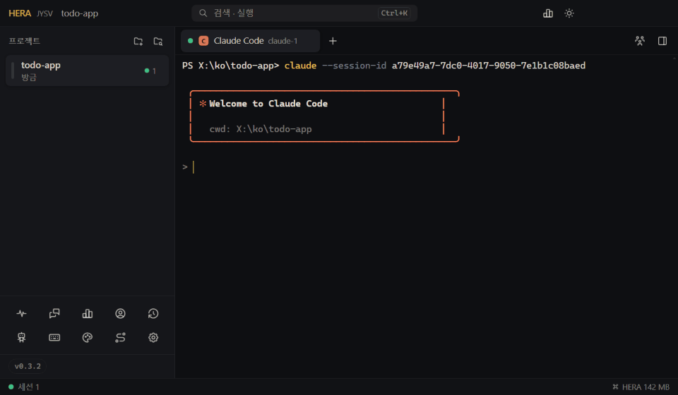
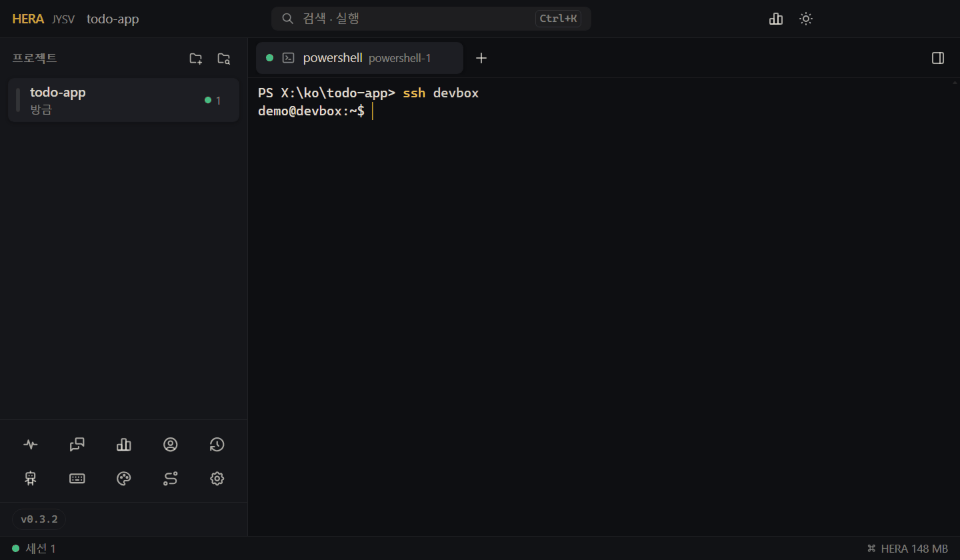
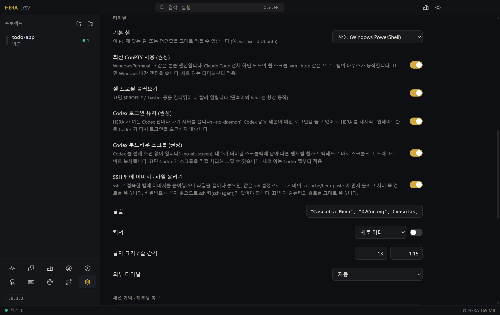
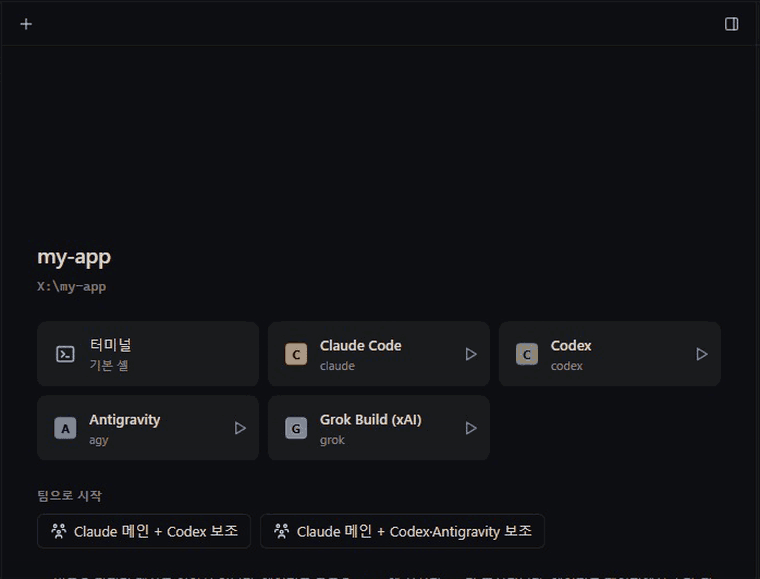
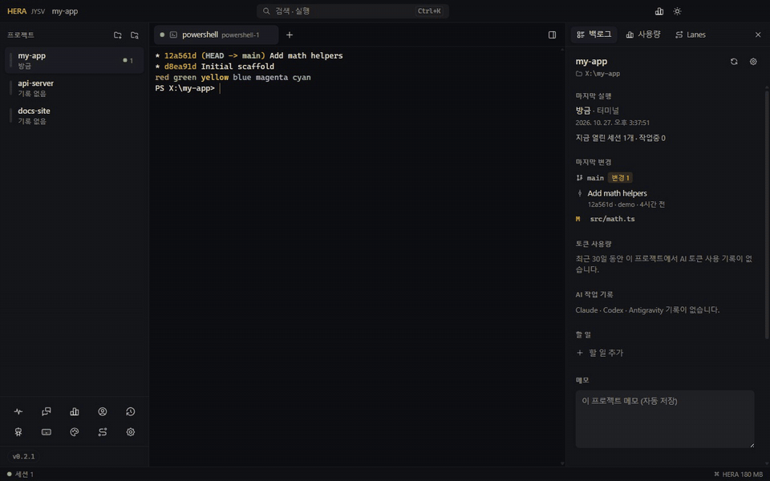

<!-- lang --><sub>[English](../en/terminal.md) · [전체 문서](README.md) · [README](../../README.ko.md)</sub>

# 터미널


HERA 는 쓰던 셸을 그대로 두고, 그 주변에 프로젝트 탭, 분할 화면, 에이전트에 필요한 기능을 더합니다.

## 탭과 분할

- `Ctrl+Shift+T` 새 터미널, `Ctrl+Shift+W` 닫기, `Ctrl+Tab` 다음 탭, `Alt+1` ~ `Alt+9` 해당 탭으로 이동. macOS 는 `⌘T`, `⌘W`.
- 탭을 더블클릭하면 이름을 바꾸고, 가운데 버튼으로 클릭하면 닫습니다.
- 탭에는 상태 점, 에이전트 아이콘, 제목, 그리고 `claude-1` 같은 짧은 이름이 보입니다. 이 짧은 이름이 [`hera` CLI](hera-cli.md) 에서 쓰는 이름입니다.
- 세션이 둘 이상이면 분할 전환 버튼으로 최대 4개를 동시에 보여 줍니다. 2개는 좌우로, 4개는 2×2, 3개는 첫 화면이 두 줄을 차지합니다. 팀에서는 각 화면에 메인 / 보조 표시가 붙습니다.

### 한 질문을 여러 AI 에게 한꺼번에

분할 화면 아래의 입력 줄에 세션이 칩으로 나열됩니다. 보낼 세션을 켜고 입력한 뒤 `Enter` (`Shift+Enter` 는 줄바꿈) 를 누르면 선택한 모든 세션에 같은 글이 들어가고, 몇 곳에 보냈는지 알림이 뜹니다.

## 복사와 붙여넣기

| 동작 | Windows / Linux | macOS |
|---|---|---|
| 선택 복사 | 글자를 선택했을 때 `Ctrl+C`, 또는 `Ctrl+Shift+C` | `⌘C` |
| 붙여넣기 | `Ctrl+V` | `⌘V` |

선택한 글자가 없으면 `Ctrl+C` 는 평소처럼 프로그램에 전달됩니다 (중단).

### 이미지 붙여넣기

터미널은 글자만 받을 수 있어서, 클립보드에 글자 없이 이미지(스크린샷 등)만 있으면 `Ctrl+V`(macOS 는 `⌘V`)가 이미지를 PNG 파일로 저장하고 그 경로를 붙여 넣습니다. Claude Code · Codex 같은 에이전트 CLI 는 입력창에 붙은 이미지 경로를 이미지 첨부로 받습니다. 일반 셸에서는 어떤 명령에든 넘길 수 있는 경로가 됩니다. 붙여넣으면 아래쪽 알림에 작은 미리보기와 크기가 나와서 무엇이 들어갔는지 바로 알 수 있습니다. 파일은 임시 폴더의 `jysv-hera-paste` 에 저장되고 일주일 뒤 지워집니다.



## 끌어다 놓기

파일이나 폴더를 터미널에 끌어다 놓으면 경로가 입력됩니다. 공백이나 특수문자가 있으면 그 탭의 셸에 맞게 따옴표가 붙습니다: PowerShell · pwsh 는 작은따옴표, cmd 는 큰따옴표, 나머지는 POSIX 방식. 브라우저 창에서 끌어온 이미지는 붙여넣은 이미지처럼 저장됩니다. 브라우저가 웹 주소로만 넘기는 이미지는 복사한 뒤 붙여넣으세요 (HERA 는 아무것도 내려받지 않습니다).

## WSL · SSH 탭

경로는 그것을 읽는 프로그램이 열 수 있어야 쓸모가 있습니다. 프로그램이 다른 곳에서 돌고 있으면 HERA 는 그곳에서 통하는 경로를 넣습니다:

| 탭 | 붙여넣은 이미지 · 끌어다 놓은 파일 |
|---|---|
| 일반 셸 | 위와 같이 이 컴퓨터의 경로. |
| WSL (`wsl.exe`, 설정의 WSL 셸) | WSL 에서 보이는 같은 파일: `C:\Users\…` 가 `/mnt/c/Users/…` 로 들어갑니다 (`wslpath` 로 찾음). |
| `ssh` 로 접속한 탭 | 파일을 먼저 그 서버로 올리고 서버의 경로를 넣습니다: `~/.cache/hera-paste/…` (예: `/home/you/.cache/hera-paste/paste-20261030-101500-1a2b3c4d.png`). |



SSH 로 올리는 방식:

- HERA 는 탭의 셸(또는 내가 그 안에서 연 셸)에서 돌고 있는 `ssh` 접속을 찾습니다: `ssh host`, 또는 `ssh -t host tmux attach` 처럼 터미널을 쓰는 명령. 명령만 실행하는 `ssh`(`ssh backup rsync …`)나 스크립트 · 프로그램이 띄운 `ssh` 는 세지 않습니다. 같은 `ssh` 를 그 탭의 폴더와 환경, 같은 로그인 옵션(`-p`, `-i`, `-J`, `-F`, `-l`, `-o` …)으로 한 번 더 실행해 파일을 올립니다. 포트 포워딩, `-t`, 원격 명령은 빼고 실행합니다.
- 비밀번호를 묻거나 대신 입력하지 않고, 호스트 키 확인 질문에서도 멈추지 않습니다(ssh 배치 모드). 키(ssh-agent, macOS · Linux 의 기존 ControlMaster 연결 포함)로 로그인되면 동작하고, 서버가 비밀번호를 원하면 아무것도 올리지 않고 알림에 이유가 나옵니다. 로그인에 한 번 실패하면 그 ssh 접속으로는 다시 시도하지 않아, 붙여넣을 때마다 서버 로그에 로그인 실패가 쌓이지 않습니다. 다시 시도하려면 `ssh` 로 새로 접속하세요.
- 뒤에서 도는 것은 없습니다. 붙여넣거나 끌어다 놓을 때만 탭을 살펴봅니다. Windows 에서는 약 0.3초, PC 어딘가에서 `ssh` 가 돌고 있으면 약 1초 걸리고, 올리기 자체는 ssh 로그인 한 번(보통 1~2초)입니다.
- 서버에 POSIX `sh` 가 있어야 합니다(Linux, macOS, BSD). 올린 파일은 내 계정만 읽을 수 있고 일주일 뒤 지워집니다. 폴더는 올리지 않고, 한 번에 파일 10개나 64MB 넘게도 올리지 않습니다.
- 알림에 어느 서버로 올렸는지 나옵니다. 올리는 동안 그 탭에 입력하면, 지금 그곳에서 도는 프로그램에 경로를 끼워 넣지 않고 클립보드에 복사한 뒤 알려 줍니다. 경로를 직접 적고 싶으면 *설정 → 터미널 → SSH 탭에 이미지 · 파일 올리기* 를 끄세요.

WSL 안에서 연 `ssh` 는 Windows 에서 보이지 않으므로, WSL 탭에는 항상 WSL 경로가 들어갑니다.



## 스크롤백

설정의 성능 · 메모리에서 줄 수를 정합니다 (500 ~ 20,000, 기본 3,000). 터미널 화면에는 더 크게 설정해도 최대 5,000줄까지만 보입니다. 탭을 바꾸거나 터미널을 숨겨도 기록은 사라지지 않습니다. HERA 가 세션마다 화면을 뒤에서 따로 들고 있다가 돌아오면 다시 그려 줍니다.

## 글꼴

HERA 에 **Cascadia Mono** 가 들어 있어서 어느 PC 에서나 기본 모양이 같습니다. 기본 글꼴 목록은 `"Cascadia Mono", "D2Coding", Consolas, "Malgun Gothic", monospace` 입니다 (macOS 는 `"SF Mono", Menlo, "D2Coding", "Apple SD Gothic Neo", monospace`). 설정 → 터미널 → 글꼴에서 목록을 고칩니다. 글자 크기 (8 ~ 28) 와 줄 간격 (1.0 ~ 2.0) 도 옆에 있습니다. 바꾸면 터미널 화면이 다시 열리지만 실행 중인 프로그램은 그대로 돕니다.

### 확대 · 축소

`Ctrl` + `+` / `-` 로 모든 터미널의 글자 크기를 한 단계씩 키우고 줄이며, `Ctrl` + `0` 은 설정한 크기로 되돌립니다. `Ctrl` 을 누른 채 마우스 휠을 굴려도 되고, macOS 는 `⌘` 와 트랙패드 핀치도 됩니다. 바꾼 배율은 다음에 켤 때도 유지되고, 실행 중인 프로그램은 새 크기에 맞춰 다시 그려집니다. `Ctrl+Shift+-` 는 셸의 되돌리기(undo)로 그대로 둡니다.

## 커서

설정 → 터미널 → 커서에서 막대 · 블록 · 밑줄과 깜빡임을 고릅니다. 열려 있는 터미널에 바로 적용됩니다.

## GPU 가속

설정 → 성능 · 메모리 → GPU 가속 (WebGL 터미널). 기본은 꺼짐이며, 켜면 일부 PC 에서 더 빨리 그립니다. 바꾼 뒤 HERA 를 다시 시작하세요.

## ConPTY: HERA 에 넣은 것과 Windows 기본 (Windows)

ConPTY 는 Windows 에서 터미널 프로그램과 셸을 이어 주는 부분입니다. HERA 는 Windows Terminal 이 쓰는 최신 ConPTY 를 함께 넣어 기본으로 사용합니다 (**최신 ConPTY 사용**). Windows 에 들어 있는 엔진은 마우스와 휠 신호를 삼켜 버려서, Claude Code 전체 화면 모드 · vim · htop 같은 전체 화면 프로그램에서 휠 스크롤이 안 되기 때문입니다. HERA 에 넣은 엔진에서는 잘 동작합니다.

<p align="center"></p>

끄면 Windows 기본 엔진을 씁니다. 그 뒤에 여는 터미널부터 적용됩니다. HERA 에 넣은 엔진으로 터미널이 시작되지 않으면 HERA 가 알아서 시스템 엔진으로 다시 시도합니다.

## 셸

기본 셸은 설정 → 터미널 → 기본 셸에서 정하고, 프로젝트마다 [프로젝트 설정](projects.md#프로젝트-설정) 에서 따로 정할 수 있습니다.

목록에는 PC 에 있는 것만 나옵니다.

- Windows PowerShell 5.1 (Windows 에서 “자동” 일 때 쓰임)
- PowerShell 7 (`pwsh`)
- 명령 프롬프트 (`cmd`)
- Git Bash
- WSL (기본 배포판)
- macOS · Linux: `bash`, `zsh`, `fish`. “자동” 은 로그인 셸 (`$SHELL`) 입니다.

그 밖의 것은 **직접 입력** 을 골라 평소 실행하듯 명령줄을 적습니다. 적은 그대로 실행됩니다.

```
wsl.exe -d Ubuntu
"C:\Program Files\Nushell\nu.exe"
```

공백이 든 경로는 따옴표로 감싸세요. PATH 에서 프로그램을 못 찾으면 HERA 가 기본 셸을 대신 엽니다.

HERA 는 사용자의 프로필 파일을 건드리지 않고, 시작할 때 `hera` 명령과 단축어만 셸마다 알맞은 방식으로 더합니다.

### 셸 프로필 불러오기

**셸 프로필 불러오기** 는 기본으로 켜져 있어서 `$PROFILE`, `.bashrc` 같은 파일이 평소처럼 실행됩니다. 끄면 터미널이 더 빨리 열립니다 (PowerShell 은 `-NoProfile` 로 시작). 어느 쪽이든 단축어와 `hera` 는 동작합니다.

## Windows Terminal 에서 가져오기

HERA 가 Windows Terminal (정식, Preview, 또는 설치 없이 쓰는 버전) 을 찾으면 설정 → 터미널에 **Windows Terminal 에서 가져오기** 카드가 나옵니다. 기본 프로필을 읽어서 다음을 가져올 수 있습니다.

<p align="center"></p>

- 글꼴 (이름과 크기. 포인트를 픽셀로 환산)
- 커서 모양
- 스크롤백
- 기본 셸 (PowerShell 7, WSL, Git Bash, cmd, 또는 적힌 명령줄 그대로)
- 터미널 색 (색 구성)

글꼴 · 커서 · 스크롤백 · 셸은 기본으로 체크되어 있고 색은 꺼져 있습니다. **선택한 항목 가져오기** 를 누르면 적용됩니다. 가져온 글꼴은 목록 맨 앞에 들어가고 한글 대체 글꼴은 그대로 남습니다. 색 구성은 “<구성 이름> (WT)” 라는 내 색상으로 추가되어, 배경 밝기에 따라 다크 또는 라이트 테마로 선택됩니다. 버튼을 누르기 전에는 아무것도 바뀌지 않고, 그 뒤에 여는 터미널부터 적용됩니다. 이 카드는 Windows 에서 Windows Terminal 설정 파일이 있을 때만 나옵니다.

## 외부 터미널에서 열기

**+** 메뉴의 **외부 터미널에서 열기** 로 HERA 밖의 터미널에서 프로젝트를 엽니다. 어떤 터미널을 쓸지는 설정 → 터미널 → 외부 터미널에서 고릅니다: 자동, macOS 는 Terminal.app / iTerm, Windows 는 Windows Terminal / 콘솔 창.
